# Sistema de gestión de una tienda comercial

## Problemática

Una tienda comercial necesita organizar la información de sus productos, proveedores, clientes y ventas. Actualmente, los registros se llevan de manera desordenada, lo que dificulta conocer las existencias, identificar los productos más vendidos y consultar los ingresos generados. Por ello, la tienda se ha propuesto utilizar una base de datos como la solución que le facilite controlar productos, proveedores, clientes, ventas y detalles de ventas, manteniendo la integridad y consistencia de la información generada en algunas de sus operaciones.

Por lo tanto, se diseñará y desarollará una base de datos que permita a la tienda administrar la información comercial y facilitar la generación de reportes. 

Los empleados de la empresa deben poder ejecutar las siguientes operaciones[^+]:
- **Listado** de todos los productos registrados.
- **Búsqueda** de productos por nombre o categoría.
- **Consulta** de las ventas realizadas.
- **Consulta** de los productos más vendidos.
- **Cálculo** del total de ventas por periodo.
- **Identificación** de productos con existencias bajas.
- **Consulta** de ventas de un cliente específico.
- Utilización de operaciones de inserción y consulta de datos.
- Generación de un reporte[^\*] que muestre los productos vendidos, las cantidades, los precios y el importe total vendido por producto.

Los puntos o conceptos más importantes de la problemática de la tienda son: `base de datos`, `productos`, `proveedores`, `clientes`, `ventas`, `detalles de ventas`, `generación de reportes`, `operaciones en la base de datos`. Estos conceptos son el núcleo de lo que el usuario (la tienda comercial) solicita como fundamental y crítico en su petición. Por lo que se comprende que la tienda no requiere control relacionado con la gestión de empleados, nómina, contabilidad y otras áreas de operación y administración. Y también, se asumirá la operación de una sola tienda, la moneda será el **peso mexicano**, la zona horaria se considerará como base el horario de la ciudad de **Cancún**. En síntesis, la tienda requiere una base de datos para apoyar a su **proceso o ciclo de compra-venta**. 

[^+]: La mayoría de las operaciones no son descritas con precisión ni claridad. Se asumirán primero reglas intuitivas y sencillas, lo demás detalles serán tratados en la fase pertinente.

[^\*]: Un reporte de productos vendidos con formato de tabla cuyas columnas sean el producto, precio, cantidades e importe total vendido por producto. La indicación no es clara ni precisa, así que se asumirá un periodo desde el inicio de operaciones de la tienda, las cantidades y el importe serán las acumuladas desde apertura y se asumirán que son de ventas, y la identificación del producto se hará con su nombre y código de identificación.

## Modelo Conceptual

### Dominio

Dada la información obtenida en el enunciado de la problemática, el sistema o proceso de la tienda comercial a modelar es el *proceso o ciclo de compra-venta*. En tal modelo, los agentes y procesos principales son la **tienda**, el **producto**, el **inventario**, la **venta** , el **cliente** y el **proveedor**. Estos agentes y procesos se consideran parte de las entidades para un modelo relacional de bases de datos. Cabe añadir que las acciones de **vender** productos, **comprar** productos, **recepcionar** mercancía, **pedir** mercancía y **entregar** mercancía forman parte de los candidatos a relación.

El proceso de compra-venta en perspectiva del producto —y de forma simplificada— se muestra en el diagrama siguiente:

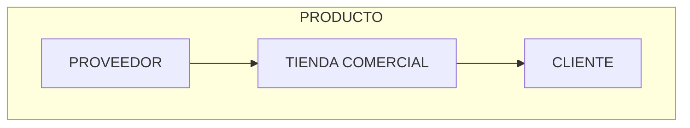

En tal flujo se observa de donde sale el producto y en donde termina, ahora tendremos que desglosar y exponer de forma descriptiva dicho diagrama. El producto es ofertado por el proveedor y este le vende dicho artículo a la tienda comercial. La tienda ingresa el producto a su inventario. La tienda le vende el artículo a un cliente, y el cliente lo compra. Es necesario aclarar que este proceso es simplificado y modela únicamente la secuencia de un único producto desde el almacén del proveedor hasta que el cliente lo hace suyo.

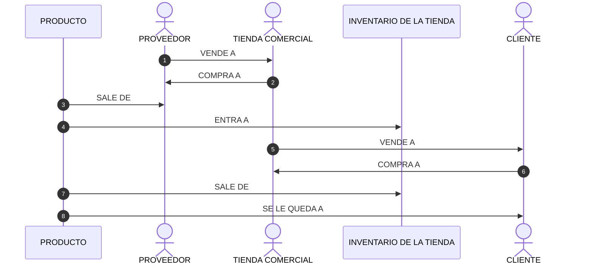

La secuencia anterior revela muy bien como se ejecuta el proceso de compra-venta de la tienda, por lo que de forma gráfica y resumida se expone más formal el proceso desde la perspectiva del producto:

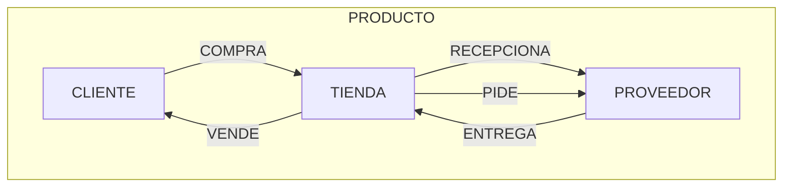

### Entidades

Una vez conocido el dominio se puede identifican las siguientes entidades:

- **Productos**.
- **Proveedores**.
- **Recepciones**.
- **Pedidos**.
- **Ventas**.
- **Clientes**.
- **Categorías**.
- **Existencias** o **inventario**.

De la lista anterior, se realiza un descarte de la entidad de **Existencias** por considerarse redundante con la existencia de la entidad de **Productos**. Esto se debe a que el primero únicamente guarda la relación de cantidades y su monto en precio de venta o costo y el segundo ya respalda las existencias de los productos y almacena los precios de costo y precio de venta. Por lo tanto, queda de esta manera las entidades para el modelo relacional:

| Entidad         | Descripción                                                                                           | Tipo de entidad |
| --------------- | ----------------------------------------------------------------------------------------------------- | --------------- |
| **Productos**   | Los artículos que vende una tienda, que adquiere el cliente y fabrica o distribuye un proveedor.      | Entidad fuerte. |
| **Proveedores** | Los agentes que entregan la mercancía a la tienda para que este lo distribuya y venda.                | Entidad fuerte. |
| **Recepciones** | El proceso de una tienda de recibir la mercancía al proveedor.                                        | Entidad fuerte. |
| **Pedidos**     | El proceso de una tienda de solicitar resurtido de mercancía al proveedor.                            | Entidad fuerte. |
| **Ventas**      | Las transacciones entre clientes y la tienda, donde el primero adquiere un artículo usando su dinero. | Entidad fuerte. |
| **Clientes**    | Los agentes que adquiere los productos ofertados por la tienda.                                       | Entidad fuerte. |
| **Categorías**  | La clasificación de la mercancía según su utilidad, caducidad u otros criterios.                      | Entidad fuerte. |

Por decisión de simplificación, las entidades anteriores descritas son *fuertes* ya que todas las anteriores se pueden identificar y existir por sí mismos ya que son abstracciones de los agentes y procesos del proceso de compra-venta.

De igual forma, se presenta las *entidades asociativas* como resultado a la solución de relaciones de cardinalidad `N:M`. En páginas siguientes se profundizará en estas relaciones.

| Entidad asociativa        | Descripción                                                              | Origen                                          |
| ------------------------- | ------------------------------------------------------------------------ | ----------------------------------------------- |
| **Catálogo de proveedor** | Los productos ofertados por los proveedores.                             | Relación entre **Productos** y **Proveedores**. |
| **Detalle de recepción**  | El desglose de mercancía recibida de un proveedor.                       | Relación entre **Productos** y **Recepciones**. |
| **Detalle de pedido**     | El desglose de mercancía solicitada a un proveedor.                      | Relación entre **Productos** y **Pedidos**.     |
| **Detalle de venta**      | El desglose de una venta, los productos y precios vendidos a un cliente. | Relación entre **Ventas** y **Productos**.      |

Las entidades se podrán identificar de dos formas:

- Productos -> `PRODUCTS`
- Proveedores -> `SUPPLIERS`
- Recepciones -> `ENTRIES`
- Pedidos -> `ORDERS`
- Ventas -> `SALES`
- Clientes -> `CUSTOMERS`
- Categorías -> `CATEGORIES`
- Catálogo de proveedor -> `SUPPLIER_CATALOGO`
- Detalle de recepción -> `ENTRY_DETAIL`
- Detalle de pedido -> `ORDER_DETAIL`
- Detalle de venta -> `SALE_DETAIL`

### Atributos de las entidades

A continuación se enumeran los *atributos* de las entidades fuertes identificadas y seleccionadas de la sección anterior.

- **Productos**:
	- Identificador de producto -> `id`,
	- Código de producto -> `sku`,
	- Nombre del producto -> `name`,
	- Precio de venta -> `salePrice` ,
	- Existencias -> `stock`, y
	- Categoría de producto -> `categoryId`.
- **Proveedores**:
	- Número o identificador de proveedor -> `id`,
	- Nombre del proveedor -> `name`,
	- Correo electrónico -> `email`, y
	- Número telefónico -> `phoneNumber`.
- **Recepciones**:
	- Número de recepción -> `id`,
	- Número de pedido a surtir -> `orderId`,
	- Referencia (número de nota de venta o de factura del proveedor) -> `reference`,
	- Fecha y hora de recepción -> `fullDate`, y
	- Valor monetario de la recepción (costo) -> `costEntry`.
- **Pedidos**:
	- Número de pedido -> `id`,
	- Número de proveedor -> `supplierId`,
	- Fecha y hora del pedido -> `fullDate`, y
	- Valor monetario del pedido (costo) -> `costOrder`.
- **Ventas**:
	- Número de venta -> `id`,
	- Fecha y hora de la venta -> `fullDate`, 
	- Número de cliente -> `customerId`, y
	- Monto de venta -> `amount`.
- **Clientes**:
	- Número de cliente -> `id`,
	- Nombre del cliente -> `name`,
	- Correo electrónico -> `email`, y
	- Número de teléfono -> `phoneNumber`.
- **Categorías**:
	- Identificador de categoría -> `id`, y
	- Categoría `category`.

Listado de atributos de las entidades asociativas:

- **Catálogo de proveedor**:
	- Número de proveedor -> `supplierId`,
	- Código de producto -> `productId`, y
	- Costo unitario -> `unitCost`.
- **Detalle de recepción**:
	- Número de recepción -> `entryId`,
	- Código de producto -> `productId`,
	- Cantidad recibida por cada producto -> `quantity`,
	- Costo unitario `unitCost`, y
	- Valor monetario total por código de producto (costo) -> `totalCost`.
- **Detalle de pedido**:
	- Número de pedido -> `orderId`,
	- Código de producto -> `productId`,
	- Cantidad solicitada de cada producto -> `quantity`,
	- Costo unitario -> `unitCost`, y
	- Valor monetario total por código de producto (costo) -> `totalCost`.
- **Detalle de venta**:
	- Número de venta -> `ticket`,
	- Código de producto -> `productId`,
	- Cantidad vendida de cada producto -> `quantity`,
	- Precio unitario (precio venta) -> `unitPrice`, y
	- Valor monetario de cada producto -> `totalSale`.

### Claves primarias

Dada la sección anterior, se ha desglosado los atributos que contienen cada entidad fuerte y cada entidad asociativa. En la tabla siguiente se define las *claves primarias* de cada entidad.

| Entidad                   | Clave primaria                                                       | Tipo de entidad     |
| ------------------------- | -------------------------------------------------------------------- | ------------------- |
| **Productos**             | Identificador de producto (`id`)                                     | Entidad fuerte.     |
| **Proveedores**           | Número o identificador de proveedor (`id`)                           | Entidad fuerte.     |
| **Recepciones**           | Número de recepción (`id`)                                           | Entidad fuerte.     |
| **Pedidos**               | Número de pedido (`id`)                                              | Entidad fuerte.     |
| **Ventas**                | Número de venta (`id`)                                               | Entidad fuerte.     |
| **Clientes**              | Número de cliente (`id`)                                             | Entidad fuerte.     |
| **Categorías**            | Identificador de categoría (`id`)                                    | Entidad fuerte.     |
| **Catálogo de proveedor** | Número de proveedor (`supplierId`); Código de producto (`productId`) | Entidad asociativa. |
| **Detalle de recepción**  | Número de recepción (`entryId`); Código de producto (`productId`)    | Entidad asociativa. |
| **Detalle de pedido**     | Número de pedido (`orderId`); Código de producto (`productId`)       | Entidad asociativa. |
| **Detalle de venta**      | Número de venta (`ticket`); Código de producto (`productId`)         | Entidad asociativa. |

### Relaciones

#### Relaciones por entidad

Una **venta** se realiza a un único **cliente** y contiene uno o varios **productos** que el cliente ha comprado. 

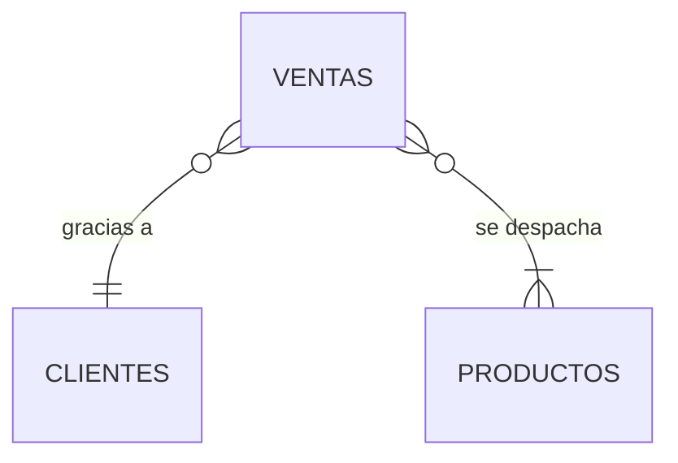

Un **cliente** puede realizar más de una compra, o no realizar ninguna. Estas compras se interpreta para la tienda como **ventas**. 


Un **proveedor** ofrece un catálogo de **productos** a la tienda y debe ofertar al menos un **producto**. También puede recibir cero o más **pedidos**; y estos lo surte o no, este último proceso es para la tienda una **recepción**.

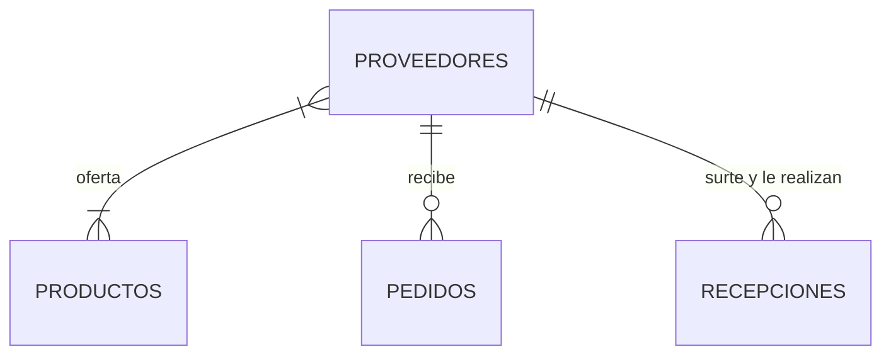

Los **pedidos** se realizan a un solo **proveedor** y en ellas se debe solicitar al menos un **producto**.

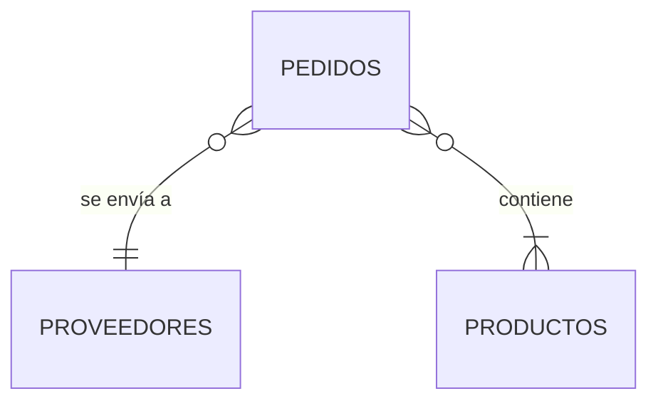

Las **recepciones** son generadas cuando un **proveedor** surte un **pedido**. Cada recepción es generada por un único proveedor y un único pedido. Se debe recepcionar al menos un **producto**.

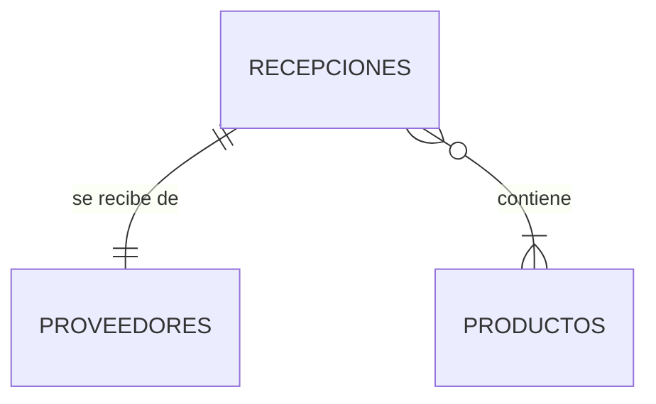

Los **productos** aparecen en ninguna o en más de una **venta**. Los productos puede ser ofertadas por uno o más **proveedores**. Un producto puede estar vinculados a cero o más **pedidos**, y de manera análoga, a cero o más **recepciones**. Cada producto está ligado a una sola **categoría**.

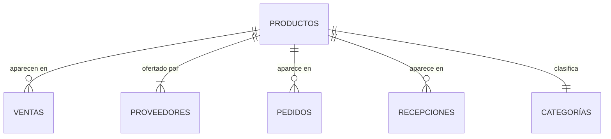

#### Relaciones entre dos entidades

A un **cliente** le pueden o no realizar una **venta**. Y toda **venta** está realizada a un único **cliente**. Esta es una relación de _cardinalidad_ `N:1`.


En una **venta** se despachan al menos un **producto**. Y todo **producto** puede aparecer en cero o más **ventas**. Esta es una relación de _cardinalidad_ `N:M`.

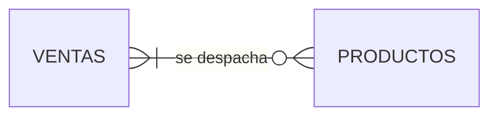

Los **productos** son ofertadas por uno o más **proveedores**. Todo **proveedor** debe ofertar al menos un **producto**.[^1] Esta es una relación de _cardinalidad_ `N:M`.

[^1]: Los proveedores se deben inscribir en un proceso aparte, si se realiza un acuerdo pero aún no oferta su catálogo o al menos un producto. Aquí solo se contempla aquellos que ya tienen cargados y disponibles su oferta.


Un **producto** tiene una sola **categoría** y una **categoría** clasifica a cero o más **productos**. Esta es una relación de _cardinalidad_ `N:1`.

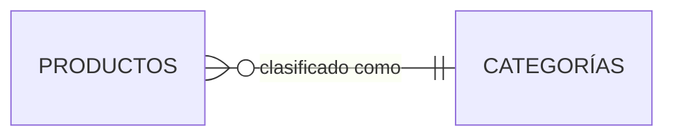

Se realiza un **pedido** con al menos un **producto**. Y todo **producto** aparece en cero o más **pedidos**. Esta es una relación de _cardinalidad_ `N:M`.


En toda **recepción** se debe recibir al menos un **producto** y cada **producto** puede estar en varias **recepciones** o en ninguna. Esta es una relación de _cardinalidad_ `N:M`.

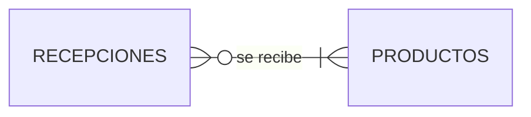

Los **proveedores** reciben varios **pedidos** o ninguno. Los **pedidos** se realizan a nombre de un solo **proveedor**. Esta es una relación de _cardinalidad_ `N:1`.


Las **recepciones** están a nombre de un solo **proveedor**. Y cada **proveedor** se le pueden realizar varias **recepciones** o ninguna. Esta es una relación de _cardinalidad_ `N:1`.


Las **recepciones** ocurren y se vinculan al surtirse un **pedido**. Un **pedido** puede generar una única **recepción** o nunca surtirse. Esta es una relación de _cardinalidad_ `1:1`.


### Relaciones N:M

Se presentan las entidades asociativas como resultado a la solución de relaciones de cardinalidad `N:M`. Son cuatro las relaciones `N:M` identificadas. Veáse las tablas de las entidades en la sección **Entidades** y revise la sección anterior. En la tabla ulterior se ilustran las claves primarias de estas relaciones.

| Entidad                   | Clave primaria 1                   | Clave primaria 2                 | Tipo de entidad     |
| ------------------------- | ---------------------------------- | -------------------------------- | ------------------- |
| **Catálogo de proveedor** | Número de proveedor (`supplierId`) | Código de producto (`productId`) | Entidad asociativa. |
| **Detalle de recepción**  | Número de recepción (`entryId`)    | Código de producto (`productId`) | Entidad asociativa. |
| **Detalle de pedido**     | Número de pedido (`orderId`)       | Código de producto (`productId`) | Entidad asociativa. |
| **Detalle de venta**      | Número de venta (`ticket`)         | Código de producto (`productId`) | Entidad asociativa. |

Veáse listado de atributos de las entidades asociativas en la sección **Atributos de las entidades**.

### Diagrama Entidad-Relación

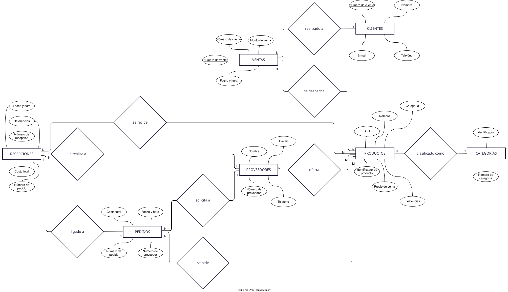

## Modelo Relacional

### Entidades en tablas

Se muestra el formato de _tabla_ las entidades descritas en las secciones anteriores incluyendo sus atributos e indicando sus llaves primarias, llaves foráneas y sus restricciones.

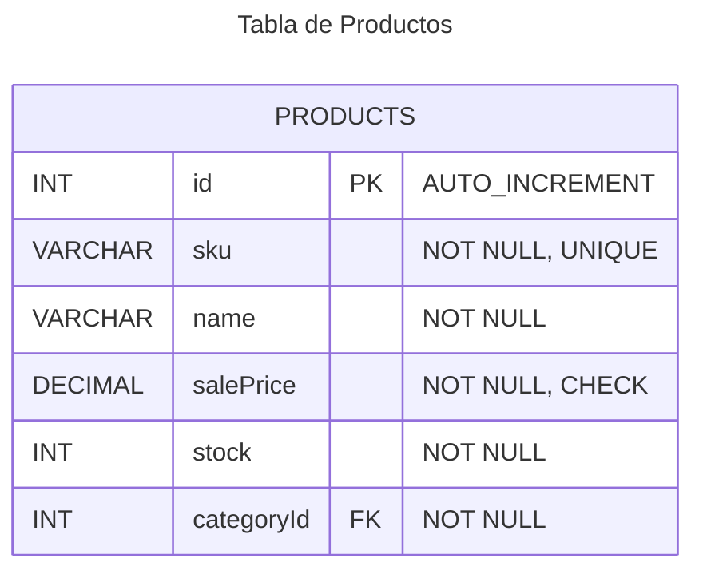

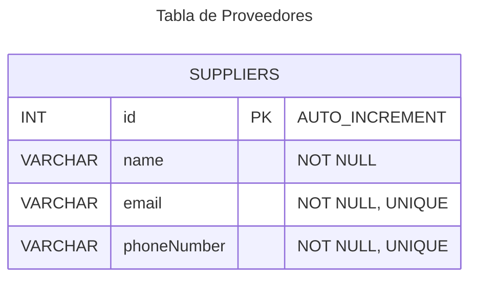

```mermaid
---
title: Tabla de Recepciones
---
erDiagram
	ENTRIES {
		INT id PK "AUTO_INCREMENT"
		INT orderId FK "NOT NULL"
		VARCHAR reference "NOT NULL"
		DATETIME fullDate "NOT NULL, DEFAULT"
		DECIMAL costEntry "NOT NULL, CHECK"
	}
```

```mermaid
---
title: Tabla de Pedidos
---
erDiagram
	ORDERS {
		INT id PK "AUTO_INCREMENT"
		INT supplierId FK "NOT NULL"
		DATETIME fullDate "NOT NULL, DEFAULT"
		DECIMAL costOrder "NOT NULL, CHECK"
	}
```

```mermaid
---
title: Tabla de Ventas
---
erDiagram
	SALES {
		INT id PK "AUTO_INCREMENT"
		DATETIME fullDate "NOT NULL, DEFAULT"
		INT customerId FK "NOT NULL"
		DECIMAL amount "NOT NULL, CHECK"
	}
```

```mermaid
---
title: Tabla de Clientes
---
erDiagram
	CUSTOMERS {
		INT id PK "AUTO_INCREMENT"
		VARCHAR name "NOT NULL"
		VARCHAR email "NOT NULL, UNIQUE"
		VARCHAR phoneNumber "NOT NULL, UNIQUE"
	}
```

```mermaid
---
title: Tabla de Categorías
---
erDiagram
	CATEGORIES {
		INT id PK "AUTO_INCREMENT"
		VARCHAR category	"NOT NULL, UNIQUE"
	}
```

```mermaid
---
title: Catálogo de proveedor
---
erDiagram
	SUPPLIER_CATALOGO {
		INT supplierId PK,FK
		INT productId PK,FK
		DECIMAL unitCost "NOT NULL, CHECK"
	}
```

```mermaid
---
title: Detalle de recepción
---
erDiagram
	ENTRY_DETAIL {
		INT entryId PK,FK
		INT productId PK,FK
		INT quantity "NOT NULL, CHECK"
		DECIMAL unitCost "NOT NULL, CHECK"
		DECIMAL totalCost "NOT NULL, CHECK"
	}
```

```mermaid
---
title: Detalle de pedido
---
erDiagram
	ORDER_DETAIL {
		INT orderId PK,FK
		INT productId PK,FK
		INT quantity "NOT NULL, CHECK"
		DECIMAL unitCost "NOT NULL, CHECK"
		DECIMAL totalCost "NOT NULL, CHECK"
	}
```

```mermaid
---
title: Detalle de venta
---
erDiagram
	SALE_DETAIL {
		INT ticket PK,FK
		INT productId PK,FK
		DECIMAL quantity "NOT NULL, CHECK"
		DECIMAL unitPrice "NOT NULL, CHECK"
		DECIMAL totalSale "NOT NULL, CHECK"
	}
```

### Relaciones y claves foráneas

Véase la sección de **Relaciones entre dos identidades**. En la tabla se muestran las claves foráneas de las entidades:

| Entidad                   | Clave foránea                                                        | Tipo de entidad     |
| ------------------------- | -------------------------------------------------------------------- | ------------------- |
| **Productos**             | Categoría de producto (`categoryId`)                                 | Entidad fuerte.     |
| **Proveedores**           |                                                                      | Entidad fuerte.     |
| **Recepciones**           | Número de pedido a surtir (`orderId`)                                | Entidad fuerte.     |
| **Pedidos**               | Número de proveedor (`supplierId`)                                   | Entidad fuerte.     |
| **Ventas**                | Número de cliente (`customerId`)                                     | Entidad fuerte.     |
| **Clientes**              |                                                                      | Entidad fuerte.     |
| **Categorías**            |                                                                      | Entidad fuerte.     |
| **Catálogo de proveedor** | Número de proveedor (`supplierId`); Código de producto (`productId`) | Entidad asociativa. |
| **Detalle de recepción**  | Número de recepción (`entryId`); Código de producto (`productId`)    | Entidad asociativa. |
| **Detalle de pedido**     | Número de pedido (`orderId`); Código de producto (`productId`)       | Entidad asociativa. |
| **Detalle de venta**      | Número de venta (`ticket`); Código de producto (`productId`)         | Entidad asociativa. |

### Restricciones de seguridad

Se aplicó `NOT NULL` a los atributos que requieran una medida adicional para evitar introducir datos vacíos como las referencias de llaves foráneas u otros casos. En las llaves primarias no se aplicó `NOT NULL` ya que estas por definición o restricción no pueden estar vacíos. Algunos atributos que pudieron ser candidatos a llave primaria así como datos de correos y números telefónicos se aplicó `UNIQUE` con la finalidad de evitar duplicaciones en campos de valores únicos o información de carácter unívoco. Por cuestiones de tiempo, no se preparó una política referencial como `ON DELETE` y `ON UPDATE` (`RESTRICT`, `CASCADE`, `SET NULL` ) y este es de lo detalles críticos que se han de trabajar en la siguiente ronda de desarrollo. Por último, algunos atributos como los campos de precios y cantidades de productos (excepto en cuestión de existencias) se aplicaron reglas de dominio `CHECK` con la finalidad de que estos tengan valores decimales no negativos.

### Normalización

El diseño cumple la **primera forma normal (1FN)** debido a que cada tabla tiene una clave primaria y sus columnas representan atributos individuales, sin repetición de valores ni conjuntos dentro de cada fila. Los datos de las entidades (procesos y agentes del proceso de compra-venta) se separaron en tablas distintas, esto para evitar la redundancia de información en múltiples tablas. También, las relaciones `N:M` se resolvieron mediante entidades (tablas) asociativas que guardan los datos de cada relación. En otras palabras, es la primera manera y la más fundamental de evitar duplicación de información aún cuando se trate de bases de datos con pocas entidades o escasa complejidad.

La **segunda forma normal (2FN)** implica que las claves primarias, en este diseño, se dividan en simples o compuestas; las simples para las entidades fuertes y las compuestas para las entidades asociativas. Estas claves permiten la identificación de cada uno de los registros. En las entidades asociativas, la combinación de claves permite identificar la relación de las operaciones y las entidades sin que haya que depender de información redundante. Además, las claves foráneas permiten referenciar las tablas de origen, en lugar de estar duplicando en cada registro la información que contiene la tabla de origen.

La **tercera forma normal (3FN)** implica el mantener los datos descriptivos en sus tablas correspondientes y referenciarlos mediante claves, evitando que atributos no clave dependan de otros atributos no clave. Es decir, que datos que se puedan calcular, recalcular y obtener mediante ciertas operaciones como las aritméticas cuyos operandos sean los mismos atributos no claves no deberían almacenarse en las tablas, basta con conservar los operandos sin registrar el resultado. Esto no ocurre en este diseño de base de datos, o al menos en la mayor parte de los atributos. Esto se ha dejado así (como los cálculos de costos, detalles de ventas, cálculo de stock) para facilitar el registro y consulta de datos para la generación de reportes que requiera la tienda comercial.

Por lo tanto, no se cumple la **3FN** de forma estricta, mientras que **1FN** y **2FN** sí. Dado que no se normalizó, de manera deliberada, bajo la tercera forma normal por decisiones de diseño, el esquema relacional está normalizado hasta donde corresponde.

### Esquema Relacional

```mermaid
erDiagram
	SALES }o--|| CUSTOMERS : ""
	SALES }|--|| SALE_DETAIL : ""
	PRODUCTS }o--|| SALE_DETAIL : ""
	PRODUCTS }o--|| CATEGORIES : ""
	SUPPLIERS }|--|| SUPPLIER_CATALOGO : ""
	PRODUCTS }|--|| SUPPLIER_CATALOGO : ""
	ORDERS }o--|| ORDER_DETAIL : ""
	PRODUCTS }|--|| ORDER_DETAIL : ""
	ENTRIES }o--|| ENTRY_DETAIL : ""
	PRODUCTS }|--|| ENTRY_DETAIL : ""
	ORDERS }o--|| SUPPLIERS : ""
	ENTRIES }o--|| SUPPLIERS : ""
	ENTRIES ||--o| ORDERS : ""

	PRODUCTS {
		INT id PK "AUTO_INCREMENT"
		VARCHAR sku "NOT NULL, UNIQUE"
		VARCHAR name "NOT NULL"
		DECIMAL salePrice "NOT NULL, CHECK"
		INT stock "NOT NULL"
		INT categoryId FK "NOT NULL"
	}

	SUPPLIERS {
		INT id PK "AUTO_INCREMENT"
		VARCHAR name "NOT NULL"
		VARCHAR email "NOT NULL, UNIQUE"
		VARCHAR phoneNumber "NOT NULL, UNIQUE"
}

	ENTRIES {
		INT id PK "AUTO_INCREMENT"
		INT orderId FK "NOT NULL"
		VARCHAR reference "NOT NULL"
		DATETIME fullDate "NOT NULL, DEFAULT"
		DECIMAL costEntry "NOT NULL, CHECK"
	}

	ORDERS {
		INT id PK "AUTO_INCREMENT"
		INT supplierId FK "NOT NULL"
		DATETIME fullDate "NOT NULL, DEFAULT"
		DECIMAL costOrder "NOT NULL, CHECK"
	}

	SALES {
		INT id PK "AUTO_INCREMENT"
		DATETIME fullDate "NOT NULL, DEFAULT"
		INT customerId FK "NOT NULL"
		DECIMAL amount "NOT NULL, CHECK"
	}

	CUSTOMERS {
		INT id PK "AUTO_INCREMENT"
		VARCHAR name "NOT NULL"
		VARCHAR email "NOT NULL, UNIQUE"
		VARCHAR phoneNumber "NOT NULL, UNIQUE"
	}

	CATEGORIES {
		INT id PK "AUTO_INCREMENT"
		VARCHAR category	"NOT NULL, UNIQUE"
	}

	SUPPLIER_CATALOGO {
		INT supplierId PK,FK
		INT productId PK,FK
		DECIMAL unitCost "NOT NULL, CHECK"
	}

	ENTRY_DETAIL {
		INT entryId PK,FK
		INT productId PK,FK
		INT quantity "NOT NULL, CHECK"
		DECIMAL unitCost "NOT NULL, CHECK"
		DECIMAL totalCost "NOT NULL, CHECK"
	}

	ORDER_DETAIL {
		INT orderId PK,FK
		INT productId PK,FK
		INT quantity "NOT NULL, CHECK"
		DECIMAL unitCost "NOT NULL, CHECK"
		DECIMAL totalCost "NOT NULL, CHECK"
	}

	SALE_DETAIL {
		INT ticket PK,FK
		INT productId PK,FK
		DECIMAL quantity "NOT NULL, CHECK"
		DECIMAL unitPrice "NOT NULL, CHECK"
		DECIMAL totalSale "NOT NULL, CHECK"
	}
```

## Diccionario de Datos

En este apartado se describe, de forma estructurada y exhaustiva, cada elemento del modelo de datos: las tablas, las columnas, los tipos, las restricciones, las claves y las relaciones. Este apartado es y será la referencia que fija el significado, el dominio y las reglas de cada dato introducido a la base de datos.

###  Por tabla (entidad)

Se han identificado 11 entidades para el modelo relacional para la base de datos, y por lo tanto, 11 tablas de especificaciones se describirán a continuación.

| Campo                | Contenido                                                                                        |
| -------------------- | ------------------------------------------------------------------------------------------------ |
| Nombre               | `PRODUCTS`                                                                                       |
| Descripción          | Los artículos que vende una tienda, que adquiere el cliente y fabrica o distribuye un proveedor. |
| Clave(s) primaria(s) | `id`                                                                                      |
| Clave(s) foránea(s)  | `categoryId`                                                                                     |

| Campo                | Contenido                                                                              |
| -------------------- | -------------------------------------------------------------------------------------- |
| Nombre               | `SUPPLIERS`                                                                            |
| Descripción          | Los agentes que entregan la mercancía a la tienda para que este lo distribuya y venda. |
| Clave(s) primaria(s) | `id`                                                                           |
| Clave(s) foránea(s)  | —                                                                                      |

| Campo                | Contenido                                                      |
| -------------------- | -------------------------------------------------------------- |
| Nombre               | `ENTRIES`                                                      |
| Descripción          | El proceso de una tienda de recibir la mercancía al proveedor. |
| Clave(s) primaria(s) | `id`                                                           |
| Clave(s) foránea(s)  | `orderId`                                                      |

| Campo                | Contenido                                                                  |
| -------------------- | -------------------------------------------------------------------------- |
| Nombre               | `ORDERS`                                                                   |
| Descripción          | El proceso de una tienda de solicitar resurtido de mercancía al proveedor. |
| Clave(s) primaria(s) | `id`                                                                  |
| Clave(s) foránea(s)  | `supplierId`                                                               |

| Campo                | Contenido                                                                                             |
| -------------------- | ----------------------------------------------------------------------------------------------------- |
| Nombre               | `SALES`                                                                                               |
| Descripción          | Las transacciones entre clientes y la tienda, donde el primero adquiere un artículo usando su dinero. |
| Clave(s) primaria(s) | `id`                                                                                              |
| Clave(s) foránea(s)  | `customerId`                                                                                          |

| Campo                | Contenido                                                       |
| -------------------- | --------------------------------------------------------------- |
| Nombre               | `CUSTOMERS`                                                     |
| Descripción          | Los agentes que adquiere los productos ofertados por la tienda. |
| Clave(s) primaria(s) | `id`                                                    |
| Clave(s) foránea(s)  | —                                                               |

| Campo                | Contenido                                                                        |
| -------------------- | -------------------------------------------------------------------------------- |
| Nombre               | `CATEGORIES`                                                                     |
| Descripción          | La clasificación de la mercancía según su utilidad, caducidad u otros criterios. |
| Clave(s) primaria(s) | `id`                                                                     |
| Clave(s) foránea(s)  | —                                                                                |

| Campo                | Contenido                                    |
| -------------------- | -------------------------------------------- |
| Nombre               | `SUPPLIER_CATALOGO`                          |
| Descripción          | Los productos ofertados por los proveedores. |
| Clave(s) primaria(s) | `supplierId`, `productId`                    |
| Clave(s) foránea(s)  | `supplierId`, `productId`                    |

| Campo                | Contenido                                          |
| -------------------- | -------------------------------------------------- |
| Nombre               | `ENTRY_DETAIL`                                     |
| Descripción          | El desglose de mercancía recibida de un proveedor. |
| Clave(s) primaria(s) | `entryId`, `productId`                             |
| Clave(s) foránea(s)  | `entryId`, `productId`                             |

| Campo                | Contenido                                           |
| -------------------- | --------------------------------------------------- |
| Nombre               | `ORDER_DETAIL`                                      |
| Descripción          | El desglose de mercancía solicitada a un proveedor. |
| Clave(s) primaria(s) | `orderId`, `produtId`                               |
| Clave(s) foránea(s)  | `orderId`, `productId`                              |

| Campo                | Contenido                                                                |
| -------------------- | ------------------------------------------------------------------------ |
| Nombre               | `SALE_DETAIL`                                                            |
| Descripción          | El desglose de una venta, los productos y precios vendidos a un cliente. |
| Clave(s) primaria(s) | `ticket`, `productId`                                                    |
| Clave(s) foránea(s)  | `ticket`, `productId`                                                    |

### Por columna (atributo)

Se han identificado 11 entidades para el modelo relacional para la base de datos, y por lo tanto, 11 tablas de especificaciones de atributos se describirán a continuación.

| Tabla      | Columna      | Tipo      | Longitud o precisión | Nulo | Clave                | Valor por defecto | Restricciones | Descripción                        |
| ---------- | ------------ | --------- | -------------------- | ---- | -------------------- | ----------------- | ------------- | ---------------------------------- |
| `PRODUCTS` | `id`         | `INT`     |                      | No   | `PK`                 | `AUTO_INCREMENT`  |               | Identificador único de producto.   |
| `PRODUCTS` | `sku`        | `VARCHAR` | 30                   | No   |                      |                   | `UNIQUE`      | Código EAN-13 u otros de producto. |
| `PRODUCTS` | `name`       | `VARCHAR` | 50                   | No   |                      |                   |               | Nombre descriptivo del producto.   |
| `PRODUCTS` | `salePrice`  | `DECIMAL` | (10, 2)              | No   |                      |                   | `CHECK >= 0`  | Precio de venta.                   |
| `PRODUCTS` | `stock`      | `INT`     |                      | No   |                      |                   |               | Existencias del producto.          |
| `PRODUCTS` | `categoryId` | `INT`     |                      | No   | `FK` -> `CATEGORIES` |                   |               | Categoría única del producto.      |

| Tabla       | Columna       | Tipo      | Longitud o precisión | Nulo | Clave | Valor por defecto | Restricciones | Descripción                          |
| ----------- | ------------- | --------- | -------------------- | ---- | ----- | ----------------- | ------------- | ------------------------------------ |
| `SUPPLIERS` | `id`          | `INT`     |                      | No   | `PK`    | `AUTO_INCREMENT`    |               | Identificador único de proveedor.    |
| `SUPPLIERS` | `name`        | `VARCHAR` | 50                   | No   |       |                   |               | Nombre o razón social del proveedor. |
| `SUPPLIERS` | `email`       | `VARCHAR` | 50                   | No   |       |                   | `UNIQUE`        | Correo electrónico del proveedor.    |
| `SUPPLIERS` | `phoneNumber` | `VARCHAR` | 20                   | No   |       |                   | `UNIQUE`        | Número telefónico del proveedor.     |

| Tabla     | Columna     | Tipo       | Longitud o precisión | Nulo | Clave            | Valor por defecto   | Restricciones | Descripción                                         |
| --------- | ----------- | ---------- | -------------------- | ---- | ---------------- | ------------------- | ------------- | --------------------------------------------------- |
| `ENTRIES` | `id`        | `INT`      |                      | No   | `PK`             | `AUTO_INCREMENT`    |               | Identificador único de recepción de mercancía.      |
| `ENTRIES` | `orderId`   | `INT`      |                      | No   | `FK` -> `ORDERS` |                     |               | Identificador de pedido.                            |
| `ENTRIES` | `reference` | `VARCHAR`  | 36                   | No   |                  |                     |               | Nota de venta o factura entregada por el proveedor. |
| `ENTRIES` | `fullDate`  | `DATETIME` |                      | No   |                  | `CURRENT_TIMESTAMP` |               | Fecha y hora de recepción.                          |
| `ENTRIES` | `costEntry` | `DECIMAL`  | (10, 2)              | No   |                  |                     | `CHECK >= 0`  | Costo total de la recepción.                        |

| Tabla    | Columna      | Tipo       | Longitud o precisión | Nulo | Clave               | Valor por defecto   | Restricciones | Descripción                                 |
| -------- | ------------ | ---------- | -------------------- | ---- | ------------------- | ------------------- | ------------- | ------------------------------------------- |
| `ORDERS` | `id`         | `INT`      |                      | No   | `PK`                | `AUTO_INCREMENT`    |               | Identificador único de pedido de mercancía. |
| `ORDERS` | `supplierId` | `INT`      |                      | No   | `FK` -> `SUPPLIERS` |                     |               | Identificador de proveedor.                 |
| `ORDERS` | `fullDate`   | `DATETIME` |                      | No   |                     | `CURRENT_TIMESTAMP` |               | Fecha y hora de solicitud de pedido.        |
| `ORDERS` | `costOrder`  | `DECIMAL`  | (10, 2)              | No   |                     |                     | `CHECK >= 0`  | Costo total del pedido.                     |

| Tabla   | Columna      | Tipo       | Longitud o precisión | Nulo | Clave               | Valor por defecto   | Restricciones | Descripción                    |
| ------- | ------------ | ---------- | -------------------- | ---- | ------------------- | ------------------- | ------------- | ------------------------------ |
| `SALES` | `id`         | `INT`      |                      | No   | `PK`                | `AUTO_INCREMENT`    |               | Identificador único de venta.  |
| `SALES` | `fullDate`   | `DATETIME` |                      | No   |                     |                     |               | Fecha y hora de la venta.      |
| `SALES` | `customerId` | `INT`      |                      | No   | `FK` -> `CUSTOMERS` | `CURRENT_TIMESTAMP` |               | Cliente vinculado a la compra. |
| `SALES` | `amount`     | `DECIMAL`  | (10,2)               | No   |                     |                     | `CHECK >= 0`  | Monto total de la venta.       |

| Tabla       | Columna       | Tipo      | Longitud o precisión | Nulo | Clave | Valor por defecto | Restricciones | Descripción                     |
| ----------- | ------------- | --------- | -------------------- | ---- | ----- | ----------------- | ------------- | ------------------------------- |
| `CUSTOMERS` | `id`          | `INT`     |                      | No   | `PK`  | `AUTO_INCREMENT`  |               | Identificador único de cliente. |
| `CUSTOMERS` | `name`        | `VARCHAR` | 50                   | No   |       |                   |               | Nombre del cliente.             |
| `CUSTOMERS` | `email`       | `VARCHAR` | 50                   | No   |       |                   | `UNIQUE`      | Correo electrónico del cliente. |
| `CUSTOMERS` | `phoneNumber` | `VARCHAR` | 20                   | No   |       |                   | `UNIQUE`      | Número telefónico del cliente.  |

| Tabla        | Columna    | Tipo      | Longitud o precisión | Nulo | Clave | Valor por defecto | Restricciones | Descripción                         |
| ------------ | ---------- | --------- | -------------------- | ---- | ----- | ----------------- | ------------- | ----------------------------------- |
| `CATEGORIES` | `id`       | `INT`     |                      | No   | `PK`  | `AUTO_INCREMENT`  |               | Identificador único de categoría.   |
| `CATEGORIES` | `category` | `VARCHAR` | 50                   | No   |       |                   | `UNIQUE`      | Nombre descriptivo de la categoría. |

| Tabla               | Columna      | Tipo      | Longitud o precisión | Nulo | Clave                     | Valor por defecto | Restricciones | Descripción                                    |
| ------------------- | ------------ | --------- | -------------------- | ---- | ------------------------- | ----------------- | ------------- | ---------------------------------------------- |
| `SUPPLIER_CATALOGO` | `supplierId` | `INT`     |                      | No   | `PK`, `FK` -> `SUPPLIERS` |                   |               | Identificador de proveedor.                    |
| `SUPPLIER_CATALOGO` | `productId`  | `INT`     |                      | No   | PK, FK -> `PRODUCTS`      |                   |               | Identificador de producto.                     |
| `SUPPLIER_CATALOGO` | `unitCost`   | `DECIMAL` | (10,2)               | No   |                           |                   | `CHECK >= 0`  | Costo unitario, precio proveedor del producto. |

| Tabla          | Columna     | Tipo      | Longitud o precisión | Nulo | Clave                    | Valor por defecto | Restricciones | Descripción                                   |
| -------------- | ----------- | --------- | -------------------- | ---- | ------------------------ | ----------------- | ------------- | --------------------------------------------- |
| `ENTRY_DETAIL` | `entryId`   | `INT`     |                      | No   | `PK`, `FK` -> `ENTRIES`  |                   |               | Identificador de recepción de mercancía.      |
| `ENTRY_DETAIL` | `productId` | `INT`     |                      | No   | `PK`, `FK` -> `PRODUCTS` |                   |               | Identificador de producto.                    |
| `ENTRY_DETAIL` | `quantity`  | `INT`     |                      | No   |                          |                   | `CHECK >= 0`  | Cantidad recibida de producto.                |
| `ENTRY_DETAIL` | `unitCost`  | `DECIMAL` | (10,2)               | No   |                          |                   | `CHECK >= 0`  | Costo unitario de producto, precio proveedor. |
| `ENTRY_DETAIL` | `totalCost` | `DECIMAL` | (10,2)               | No   |                          |                   | `CHECK >= 0`  | Costo total por producto                      |

| Tabla          | Columna     | Tipo      | Longitud o precisión | Nulo | Clave                    | Valor por defecto | Restricciones | Descripción                                   |
| -------------- | ----------- | --------- | -------------------- | ---- | ------------------------ | ----------------- | ------------- | --------------------------------------------- |
| `ORDER_DETAIL` | `orderId`   | `INT`     |                      | No   | `PK`, `FK` -> `ORDERS`   |                   |               | Identificador de pedido de mercancía.         |
| `ORDER_DETAIL` | `productId` | `INT`     |                      | No   | `PK`, `FK` -> `PRODUCTS` |                   |               | Identificador de producto.                    |
| `ORDER_DETAIL` | `quantity`  | `INT`     |                      | No   |                          |                   | `CHECK >= 0`  | Cantidad solicitada de producto.              |
| `ORDER_DETAIL` | `unitCost`  | `DECIMAL` | (10,2)               | No   |                          |                   | `CHECK >= 0`  | Costo unitario de producto, precio proveedor. |
| `ORDER_DETAIL` | `totalCost` | `DECIMAL` | (10,2)               | No   |                          |                   | `CHECK >= 0`  | Costo total por producto                      |

| Tabla         | Columna     | Tipo      | Longitud o precisión | Nulo | Clave                    | Valor por defecto | Restricciones | Descripción                                    |
| ------------- | ----------- | --------- | -------------------- | ---- | ------------------------ | ----------------- | ------------- | ---------------------------------------------- |
| `SALE_DETAIL` | `ticket`    | `INT`     |                      | No   | `PK`, `FK` -> `ORDERS`   |                   |               | Identificador de venta.                        |
| `SALE_DETAIL` | `productId` | `INT`     |                      | No   | `PK`, `FK` -> `PRODUCTS` |                   |               | Identificador de producto.                     |
| `SALE_DETAIL` | `quantity`  | `INT`     |                      | No   |                          |                   | `CHECK >= 0`  | Cantidad vendida de producto.                  |
| `SALE_DETAIL` | `unitPrice` | `DECIMAL` | (10,2)               | No   |                          |                   | `CHECK >= 0`  | Precio unitario, precio de venta del producto. |
| `SALE_DETAIL` | `totalSale` | `DECIMAL` | (10,2)               | No   |                          |                   | `CHECK >= 0`  | Monto total de venta.                          |

### Por relación

Se han identificado 9 relaciones principales para el modelo relacional para la base de datos, y por lo tanto, 9 relaciones se describirán a continuación.

| Relación                | Entidades                                    | Cardinalidad | Política referencial |
| ----------------------- | -------------------------------------------- | ------------ | -------------------- |
| `SALES - CUSTOMERS`     | `SALES`, `CUSTOMERS`                         | `N:1`        | No implementado.     |
| `SALES - PRODUCTS`      | `SALES`, `SALE_DETAIL`, `PRODUCTS`           | `N:M`        | No implementado.     |
| `SUPPLIERS - PRODUCTS`  | `SUPPLIERS`, `SUPPLIER_CATALOGO`, `PRODUCTS` | `N:M`        | No implementado.     |
| `PRODUCTS - CATEGORIES` | `PRODUCTS`, `CATEGORIES`                     | `N:1`        | No implementado.     |
| `ORDERS - PRODUCTS`     | `ORDERS`, `ORDER_DETAIL`, `PRODUCTS`         | `N:M`        | No implementado.     |
| `ENTRIES - PRODUCTS`    | `ENTRIES`, `ENTRY_DETAIL`, `PRODUCTS`        | `N:M`        | No implementado.     |
| `ORDERS - SUPPLIERS`    | `ORDERS`, `SUPPLIERS`                        | `N:1`        | No implementado.     |
| `ENTRIES - SUPPLIERS`   | `ENTRIES`, `SUPPLIERS`                       | `N:1`        | No implementado.     |
| `ENTRIES - ORDERS`      | `ENTRIES`, `ORDERS`                          | `1:1`        | No implementado.     |

## Implementación de la Base de Datos

### Gestión de base de datos

```sql
SHOW DATABASES; -- Ver bases de datos existentes en el servidor.

CREATE DATABASE IF NOT EXISTS PURCHASE_SALE_MANAGEMENT; -- Crear la base de datos.

USE PURCHASE_SALE_MANAGEMENT; -- Seleccionar la base de datos anteriormente creada.

SELECT DATABASE(); -- Verificamos que base de datos tenemos seleccionada.

SHOW TABLES; -- Verificamos las tablas que contiene nuestra base de datos.
```

### Definición de tablas

```sql
-- Tabla de Categorías
CREATE TABLE IF NOT EXISTS CATEGORIES (
	id INT AUTO_INCREMENT,
	category VARCHAR(50) NOT NULL UNIQUE,
	
	PRIMARY KEY (id)
);

-- Tabla de Productos
CREATE TABLE IF NOT EXISTS PRODUCTS (
	id INT AUTO_INCREMENT,
	sku VARCHAR(30) NOT NULL UNIQUE,
	name VARCHAR(50) NOT NULL,
	salePrice DECIMAL(10, 2) NOT NULL CHECK (salePrice >= 0),
	stock INT NOT NULL,
	categoryId INT NOT NULL,
	
	PRIMARY KEY (id),
	FOREIGN KEY (categoryId) REFERENCES CATEGORIES(id)
);

-- Tabla de Proveedores
CREATE TABLE IF NOT EXISTS SUPPLIERS (
	id INT AUTO_INCREMENT,
	name VARCHAR(50) NOT NULL,
	email VARCHAR(50) NOT NULL UNIQUE,
	phoneNumber VARCHAR(20) NOT NULL UNIQUE,
	
	PRIMARY KEY (id)
);

-- Tabla de Pedidos
CREATE TABLE IF NOT EXISTS ORDERS (
	id INT AUTO_INCREMENT,
	supplierId INT NOT NULL,
	fullDate DATETIME NOT NULL DEFAULT CURRENT_TIMESTAMP,
	costOrder DECIMAL(10, 2) NOT NULL CHECK (costOrder >= 0),
	
	PRIMARY KEY (id),
	FOREIGN KEY (supplierId) REFERENCES SUPPLIERS(id)
);

-- Tabla de Recepciones
CREATE TABLE IF NOT EXISTS ENTRIES (
	id INT AUTO_INCREMENT,
	orderId INT NOT NULL,
	reference VARCHAR(36) NOT NULL,
	fullDate DATETIME NOT NULL DEFAULT CURRENT_TIMESTAMP,
	costEntry DECIMAL(10, 2) NOT NULL CHECK (costEntry >= 0),
	
	PRIMARY KEY (id),
	FOREIGN KEY (orderId) REFERENCES ORDERS(id)
);

-- Tabla de Clientes
CREATE TABLE IF NOT EXISTS CUSTOMERS (
	id INT AUTO_INCREMENT,
	name VARCHAR(50) NOT NULL,
	email VARCHAR(50) NOT NULL UNIQUE,
	phoneNumber VARCHAR(20) NOT NULL UNIQUE,
	
	PRIMARY KEY (id)
);

-- Tabla de Ventas
CREATE TABLE IF NOT EXISTS SALES (
	id INT AUTO_INCREMENT,
	fullDate DATETIME NOT NULL DEFAULT CURRENT_TIMESTAMP,
	customerId INT NOT NULL,
	amount DECIMAL(10, 2) NOT NULL CHECK (amount >= 0),
	
	PRIMARY KEY (id),
	FOREIGN KEY (customerId) REFERENCES CUSTOMERS(id)
);

-- Catálogo de Proveedor
CREATE TABLE IF NOT EXISTS SUPPLIER_CATALOGO (
	supplierId INT,
	productId INT,
	unitCost DECIMAL(10, 2) NOT NULL CHECK (unitCost >= 0),
	
	PRIMARY KEY (supplierId, productId),
	FOREIGN KEY (supplierId) REFERENCES SUPPLIERS(id),
	FOREIGN KEY (productId) REFERENCES PRODUCTS(id)
);

-- Detalle de Recepción
CREATE TABLE IF NOT EXISTS ENTRY_DETAIL (
	entryId INT,
	productId INT,
	quantity INT NOT NULL CHECK (quantity >= 0),
	unitCost DECIMAL(10, 2) NOT NULL CHECK (unitCost >= 0),
	totalCost DECIMAL(10, 2) NOT NULL CHECK (totalCost >= 0),
	
	PRIMARY KEY (entryId, productId),
	FOREIGN KEY (entryId) REFERENCES ENTRIES (id),
	FOREIGN KEY (productId) REFERENCES PRODUCTS (id)
);

-- Detalle de Pedido
CREATE TABLE IF NOT EXISTS ORDER_DETAIL (
	orderId INT,
	productId INT,
	quantity INT NOT NULL CHECK (quantity >= 0),
	unitCost DECIMAL(10, 2) NOT NULL CHECK (unitCost >= 0),
	totalCost DECIMAL(10, 2) NOT NULL CHECK (totalCost >= 0),
	
	PRIMARY KEY (orderId, productId),
	FOREIGN KEY (orderId) REFERENCES ORDERS (id),
	FOREIGN KEY (productId) REFERENCES PRODUCTS (id)
);

-- Detalle de Venta
CREATE TABLE IF NOT EXISTS SALE_DETAIL (
	ticket INT,
	productId INT,
	quantity INT NOT NULL CHECK (quantity >= 0),
	unitPrice DECIMAL(10, 2) NOT NULL CHECK (unitPrice >= 0),
	totalSale DECIMAL(10, 2) NOT NULL CHECK (totalSale >= 0),
	
	PRIMARY KEY (ticket, productId),
	FOREIGN KEY (ticket) REFERENCES SALES(id),
	FOREIGN KEY (productId) REFERENCES PRODUCTS(id)
);
```

### Inserción fundamental de datos

Inserción fundamental de datos para dejar habilitada la base de datos para su primer y posteriores usos. Para operar la tienda primero debe definir las categorías de productos, dar de alta los productos y después a los proveedores. Una vez hecho esto, ya podemos generar el catálogo de los proveedores y la lista de clientes.

```sql
-- Registrar categorías, sola la categoría GENERAL es obligatoria al principio.
INSERT INTO CATEGORIES (category)
VALUES
	("ALIMENTOS Y BEBIDAS"),
	("ALIMENTOS FRESCOS"),
	("CUIDADO PERSONAL Y BELLEZA"),
	("LIMPIEZA DEL HOGAR"),
	("MODA, ROPA Y CALZADO"),
	("ELECTRÓNICA Y TECNOLOGÍA"),
	("ELECTRODOMÉSTICOS Y HOGAR"),
	("FARMACIA Y SALUD"),
	("MASCOTAS"),
	("JUGUETERÍA Y ENTRETENIMIENTO"),
	("GENERAL");

-- Registrar productos, aquí es necesario los productos para poder vender.
INSERT INTO PRODUCTS (sku, name, salePrice, stock, categoryId)
VALUES
	("AB-001", "REFRESCO COLA 600ML", 18.50, 0, 1),  
	("AB-002", "ARROZ EXTRA GRANO ENTERO 1KG", 24.00, 0, 1),  
	("FR-001", "PLATANO TABASCO KG", 29.90, 0, 2),  
	("FR-002", "LECHE ENTERA PASTEURIZADA 1L", 27.50, 0, 2),  
	("CP-001", "CHAMPU CONTROL CASPA 400ML", 65.00, 0, 3),  
	("CP-002", "PASTA DENTAL MAX FRESCURA 100ML", 32.50, 0, 3),  
	("LH-001", "DETERGENTE LIQ ROPA COLOR 1L", 48.00, 0, 4),  
	("LH-002", "PAPEL HIGIENICO MULTIROLLO 4PZ", 35.00, 0, 4),  
	("MR-001", "PLAYERA CABALLERO ALGODON G", 129.00, 0, 5),  
	("MR-002", "TENIS DEPORTIVO NEGRO MULTITALLA", 599.00, 0, 5),  
	("ET-001", "SMART TV LED 43 PULGADAS 4K", 4499.00, 0, 6),  
	("ET-002", "CABLE DE CARGA USB C A C 1M", 99.00, 0, 6),  
	("EH-001", "LICUADORA 2 VELOCIDADES VASO VIDRIO", 450.00, 0, 7),  
	("EH-002", "HORNO DE MICROONDAS 0.7P3 GRIS", 1399.00, 0, 7),  
	("FS-001", "PARACETAMOL TABLETAS 500MG 20PZ", 25.00, 0, 8),  
	("FS-002", "ALCOHOL GEL ANTIBACTERIAL 500ML", 42.00, 0, 8),  
	("PM-001", "ALIMENTO PERRO ADULTO RAZA MDA 2KG", 185.00, 0, 9),  
	("PM-002", "ARENA GATO CONTROL OLOR 5KG", 120.00, 0, 9),  
	("JE-001", "JUEGO DE MESA ESTRATEGIA FAMILIAR", 299.00, 0, 10),  
	("JE-002", "MUNECA ARTICULADA CON ACCESORIOS", 249.00, 0, 10);

-- Registrar proveedores.
INSERT INTO SUPPLIERS (name, email, phoneNumber)
VALUES
	("DISTRIBUIDORA DE ABARROTES SA", "contacto@distribuidora.abarrotes.com.mx", "525551111234"),  
	("ALIMENTOS FRESCOS DEL CAMPO", "ventas@alimentosfrescoscampo.com.mx", "525552222345"),  
	("PRODUCTOS DE BELLEZA CORPORAL", "info@bellezacorporal.com.mx", "525553333456"),  
	("QUIMICOS Y LIMPIEZA NACIONAL", "contacto@quimicoslimpieza.com.mx", "525554444567"),  
	("TEXTILES Y MODA MAYORISTA", "ventas@textilesymodamayorista.com", "525555555678"),  
	("TECNOLOGIA Y ELECTRONICA MX", "soporte@tecnologiamx.com.mx", "525556666789"),  
	("ELECTRODOMESTICOS DEL HOGAR", "comercial@electrodomesticoshogar.com", "525557777890"),  
	("FARMACEUTICA Y SALUD GLOBAL", "contacto@farmaceuticasalud.com.mx", "525558888901"),  
	("LOGISTICA Y NUTRICION ANIMAL", "ventas@nutricionanimal.com.mx", "525559999012"),  
	("DISTRIBUIDORA DE JUGUETES MEX", "info@juguetesmex.com.mx", "525550000123");
	
-- Registrar Catálogo de Proveedores, primero se debe tener a la mano los números de proveedor y su producto.
SELECT * FROM SUPPLIERS; -- Para ver identificadores de proveedor.
SELECT * FROM PRODUCTS; -- Para ver identificadores de producto.

INSERT INTO SUPPLIER_CATALOGO (supplierId, productId, unitCost)
VALUES
	(1, 1, 12.95),
	(1, 2, 16.80),
	(2, 3, 20.93),
	(2, 4, 19.25),
	(3, 5, 45.50),
	(3, 6, 22.75),
	(4, 7, 33.60),
	(4, 8, 24.50),
	(5, 9, 90.30),
	(5, 10, 419.30),
	(6, 11, 3149.30),
	(6, 12, 69.30),
	(7, 13, 315.00),
	(7, 14, 979.30),
	(8, 15, 17.50),
	(8, 16, 29.40),
	(9, 17, 129.50),
	(9, 18, 84.00),
	(10, 19, 209.30),
	(10, 20, 174.30);
	
-- Registrar Clientes, solo el cliente general es obligatorio.
INSERT INTO CUSTOMERS (name, email, phoneNumber)
VALUES
	("PÚBLICO GENERAL", "null@tiendacomercial.com", "000000000000"),
	("MARIA RODRIGUEZ LOPEZ", "maria.rodriguez@email.com", "525552345678"),
	("ALEJANDRO MARTINEZ DIAZ", "alejandro.martinez@email.com", "525553456789"),
	("ANA HERNANDEZ SILVA", "ana.hernandez@email.com", "525554567890"),  
	("CARLOS RAMIREZ TORRES", "carlos.ramirez@email.com", "525555678901"),  
	("LAURA FLORES CASTRO", "laura.flores@email.com", "525556789012"),  
	("REGINA SANCHEZ RUIZ", "regina.sanchez@email.com", "525557890123"),  
	("DIEGO ESPINOZA MEJIA", "diego.espinoza@email.com", "525558901234"),  
	("SOFIA MORALES ORTIZ", "sofia.morales@email.com", "525559012345"),
	("JAVIER GUTIERREZ REYES", "javier.gutierrez@email.com", "525550123456");
```

Una vez hecho lo anterior, debemos generar pedidos a los proveedores, recibir mercancía y modificar las existencias de los productos. En paralelo, se generan los detalles de los primeros pedidos, luego el de la recepción. Con ello tenemos listo el stock para vender.

```sql
-- Realización de un pedido y generación de su detalle.
SELECT * FROM SUPPLIERS; -- Número de proveedor

INSERT INTO ORDERS (supplierId, fullDate, costOrder)
VALUES
	(1, NOW(), 0.00),
	(2, NOW(), 0.00),
	(3, NOW(), 0.00),
	(4, NOW(), 0.00),
	(5, NOW(), 0.00),
	(6, NOW(), 0.00),
	(7, NOW(), 0.00),
	(8, NOW(), 0.00),
	(9, NOW(), 0.00),
	(10, NOW(), 0.00); -- Se genera varios pedidos sin solicitar productos.

INSERT INTO ORDER_DETAIL (orderId, productId, quantity, unitCost, totalCost)
VALUES
	(1, 1, 10, 12.95, 129.50),
	(1, 2, 5, 16.80, 84.00),
	(2, 3, 15, 20.93, 313.95),
	(2, 4, 20, 19.25, 385.00),
	(3, 5, 8, 45.50, 364.00),
	(3, 6, 12, 22.75, 273.00),
	(4, 7, 6, 33.60, 201.60),
	(4, 8, 25, 24.50, 612.50),
	(5, 9, 15, 90.30, 1354.50),
	(5, 10, 4, 419.30, 1677.20),
	(6, 11, 2, 3149.30, 6298.60),
	(6, 12, 50, 69.30, 3465.00),
	(7, 13, 10, 315.00, 3150.00),
	(7, 14, 3, 979.30, 2937.90),
	(8, 15, 40, 17.50, 700.00),
	(8, 16, 30, 29.40, 882.00),
	(9, 17, 12, 129.50, 1554.00),
	(9, 18, 18, 84.00, 1512.00),
	(10, 19, 7, 209.30, 1465.10),
	(10, 20, 9, 174.30, 1568.70); -- Se añade productos a cada pedido, también es necesario primero utilizar las consultas secundarias para ver catálogo de productos.

UPDATE ORDERS
SET costOrder = COALESCE((
    SELECT SUM(ORDER_DETAIL.totalCost)
    FROM ORDER_DETAIL
    WHERE ORDER_DETAIL.orderId = ORDERS.id
), 0)
WHERE id > 0; -- Se actualiza los valores de los pedidos.

-- Recepción de mercancías.
INSERT INTO ENTRIES (orderId, reference, fullDate, costEntry)
VALUES
	(1, "923-123", NOW(), 0.00),
	(2, "ABC-ABC", NOW(), 0.00),
	(3, "ENT-444", NOW(), 0.00),
	(4, "ENT-456", NOW(), 0.00),
	(5, "AAA-AA5", NOW(), 0.00),
	(6, "ENT-AA6", NOW(), 0.00),
	(7, "888-008", NOW(), 0.00),
	(8, "123-008", NOW(), 0.00),
	(9, "133-999", NOW(), 0.00),
	(10, "999-QWE", NOW(), 0.00); -- Se genera varias recepciones.
	
INSERT INTO ENTRY_DETAIL (entryId, productId, quantity, unitCost, totalCost)
VALUES
	(1, 1, 10, 12.95, 129.50),
	(1, 2, 5, 16.80, 84.00),
	(2, 3, 15, 20.93, 313.95),
	(2, 4, 20, 19.25, 385.00),
	(3, 5, 8, 45.50, 364.00),
	(3, 6, 12, 22.75, 273.00),
	(4, 7, 6, 33.60, 201.60),
	(4, 8, 25, 24.50, 612.50),
	(5, 9, 15, 90.30, 1354.50),
	(5, 10, 4, 419.30, 1677.20),
	(6, 11, 2, 3149.30, 6298.60),
	(6, 12, 50, 69.30, 3465.00),
	(7, 13, 10, 315.00, 3150.00),
	(7, 14, 3, 979.30, 2937.90),
	(8, 15, 40, 17.50, 700.00),
	(8, 16, 30, 29.40, 882.00),
	(9, 17, 12, 129.50, 1554.00),
	(9, 18, 18, 84.00, 1512.00),
	(10, 19, 7, 209.30, 1465.10),
	(10, 20, 9, 174.30, 1568.70); -- Se añaden productos recibidos, también es necesario primero utilizar las consultas secundarias de pedido y catálogo de proveedores.
	
UPDATE ENTRIES
SET costEntry = COALESCE((
    SELECT SUM(ENTRY_DETAIL.totalCost)
    FROM ENTRY_DETAIL
    WHERE ENTRY_DETAIL.entryId = ENTRIES.id
), 0)
WHERE id > 0; -- Se actualiza los costos de productos recibidos.

-- Actualización de mercancías.
UPDATE PRODUCTS
JOIN (
    SELECT productId, SUM(quantity) AS receivedQuantity
    FROM ENTRY_DETAIL
    WHERE entryId IN (1, 2, 3, 4, 5, 6, 7, 8, 9, 10)
    GROUP BY productId
) AS received
    ON PRODUCTS.id = received.productId
SET PRODUCTS.stock = PRODUCTS.stock + received.receivedQuantity
WHERE PRODUCTS.id > 0; -- Se actualiza el stock usando los números de recepción.
``` 

Se realiza una venta, luego se genera el detalle de una venta. A partir de aquí se puede realizar las operaciones del proceso de compra-venta: pedidos (y sus detalles), recepciones (y sus detalles), alta de proveedores y productos, alta de clientes, ventas (y detalles). Las correcciones y bajas de pedidos, recepciones, productos, clientes y ventas aún no se pueden realizar de manera fiable. Sin embargo, se listará la modificación de stock en los productos por ser relevante para realizar ventas.

```sql
-- Se ejecuta varias ventas.
INSERT INTO SALES (fullDate, customerId, amount)
VALUES
	(NOW(), 1, 0.00),
	(NOW(), 1, 0.00),
	(NOW(), 1, 0.00),
	(NOW(), 8, 0.00),
	(NOW(), 1, 0.00),
	(NOW(), 1, 0.00),
	(NOW(), 1, 0.00),
	(NOW(), 2, 0.00),
	(NOW(), 5, 0.00),
	(NOW(), 1, 0.00); -- Se genera los tickets.

-- Se genera el detalle de venta.
INSERT INTO SALE_DETAIL (ticket, productId, quantity, unitPrice, totalSale)
VALUES
	(1, 1, 3, 18.50, 55.50),
	(1, 2, 2, 24.00, 48.00),
	(1, 3, 1, 29.90, 29.90),
	(2, 4, 4, 27.50, 110.00),
	(2, 6, 2, 32.50, 65.00),
	(2, 8, 1, 35.00, 35.00),
	(3, 1, 1, 18.50, 18.50),
	(3, 2, 1, 24.00, 24.00),
	(3, 7, 2, 48.00, 96.00),
	(4, 5, 1, 65.00, 65.00),
	(4, 12, 3, 99.00, 297.00),
	(5, 3, 2, 29.90, 59.80),
	(5, 15, 6, 25.00, 150.00),
	(5, 16, 2, 42.00, 84.00),
	(6, 2, 3, 24.00, 72.00),
	(6, 11, 1, 4499.00, 4499.00),
	(6, 13, 1, 450.00, 450.00),
	(7, 1, 4, 18.50, 74.00),
	(7, 4, 2, 27.50, 55.00),
	(7, 8, 3, 35.00, 105.00),
	(7, 18, 1, 120.00, 120.00),
	(8, 6, 2, 32.50, 65.00),
	(8, 9, 1, 129.00, 129.00),
	(8, 17, 2, 185.00, 370.00),
	(9, 7, 2, 48.00, 96.00),
	(9, 14, 1, 1399.00, 1399.00),
	(10, 15, 4, 25.00, 100.00),
	(10, 19, 1, 299.00, 299.00),
	(10, 20, 1, 249.00, 249.00); -- Se genera los detalles de las ventas.
	
UPDATE SALES
SET amount = COALESCE((
    SELECT SUM(SALE_DETAIL.totalSale)
    FROM SALE_DETAIL
    WHERE SALE_DETAIL.ticket = SALES.id
), 0)
WHERE id > 0; -- Se actualiza el monto de venta.

-- Actualización del stock.
UPDATE PRODUCTS
JOIN (
    SELECT productId, SUM(quantity) AS soldQuantity
    FROM SALE_DETAIL
    WHERE ticket IN (1, 2, 3, 4, 5, 6, 7, 8, 9, 10)
    GROUP BY productId
) AS sold
    ON PRODUCTS.id = sold.productId
SET PRODUCTS.stock = PRODUCTS.stock - sold.soldQuantity
WHERE PRODUCTS.id > 0; -- Se actualiza el stock usando los tickets.
```

### Operaciones solicitadas por la empresa

```sql
-- Listado de todos los productos registrados.
SELECT
	PRODUCTS.id AS "NO.",
	PRODUCTS.sku AS "SKU",
	PRODUCTS.name AS "PRODUCTO",
	CATEGORIES.category AS "CATEGORÍA"
FROM PRODUCTS
INNER JOIN CATEGORIES
ON PRODUCTS.categoryId = CATEGORIES.id
ORDER BY PRODUCTS.name asc;

-- Búsqueda de productos por nombre o categoría.
SELECT
	PRODUCTS.id AS "NO.",
	PRODUCTS.sku AS "SKU",
	PRODUCTS.name AS "PRODUCTO",
	CATEGORIES.category AS "CATEGORÍA"
FROM PRODUCTS
INNER JOIN CATEGORIES
ON PRODUCTS.categoryId = CATEGORIES.id
WHERE
	PRODUCTS.name = "REFRESCO COLA 600ML" -- Reemplazar valor de nombre.
ORDER BY PRODUCTS.name asc; -- Búsqueda por nombre.

SELECT
	PRODUCTS.id AS "NO.",
	PRODUCTS.sku AS "SKU",
	PRODUCTS.name AS "PRODUCTO",
	CATEGORIES.category AS "CATEGORÍA"
FROM PRODUCTS
INNER JOIN CATEGORIES
ON PRODUCTS.categoryId = CATEGORIES.id
WHERE
	CATEGORIES.category = "ALIMENTOS Y BEBIDAS" -- Reemplazar valor de categoría.
ORDER BY PRODUCTS.name asc; -- Búsqueda por categoría.

-- Consulta de las ventas realizadas.
SELECT
	id AS "NO.",
	DAY(fullDate) AS "DÍA",
	fullDate AS "FECHA",
	amount AS "TOTAL"
FROM SALES
ORDER BY fullDate DESC
LIMIT 1000000; -- Límite modificable.

-- Consulta de los productos más vendidos.
SELECT
	PRODUCTS.id AS "NO.",
	PRODUCTS.sku AS "SKU",
	PRODUCTS.name AS "PRODUCTO",
	SUM(SALE_DETAIL.quantity) AS "CANTIDADES VENDIDAS",
	SUM(SALE_DETAIL.totalSale) AS "VENTAS ACUMULADAS (MXN)"
FROM SALE_DETAIL
INNER JOIN PRODUCTS
ON SALE_DETAIL.productId = PRODUCTS.id
GROUP BY PRODUCTS.id
ORDER BY SUM(SALE_DETAIL.quantity) DESC -- Lo más vendido no siempre es lo que más ingresos genera.
LIMIT 100; -- Se puede modificar este límite.

-- Cálculo del total de ventas por periodo.
SELECT
	SUM(amount) AS "VENTAS DEL PERIODO (MXN)"
FROM SALES
WHERE fullDate >= "2026-01-01" AND fullDate < "2027-01-01"; -- Las fechas son entradas del usuario. La fecha final es excluyente, la fecha final es el día siguiente del fin de periodo.

-- Identificación de productos con existencias bajas.
SELECT
	id AS "NO.",
	sku AS "SKU",
	name AS "PRODUCTO",
	stock AS "EXISTENCIAS"
FROM PRODUCTS
ORDER BY stock
LIMIT 100; -- Se puede modificar este límite.

-- Consulta de ventas de un cliente específico.
SELECT -- Consulta por CUSTOMERS.id
	SALES.id AS "TICKET",
	SALES.fullDate AS "FECHA",
	SALES.amount AS "MONTO (MXN)"
FROM SALES
INNER JOIN CUSTOMERS
ON SALES.customerId = CUSTOMERS.id
WHERE
	CUSTOMERS.id = 1 -- Reemplazar valor de ID.
ORDER BY fullDate DESC
LIMIT 1000000;

SELECT -- Consulta por CUSTOMERS.name
	SALES.id AS "TICKET",
	SALES.fullDate AS "FECHA",
	SALES.amount AS "MONTO (MXN)"
FROM SALES
INNER JOIN CUSTOMERS
ON SALES.customerId = CUSTOMERS.id
WHERE
	CUSTOMERS.name = "PÚBLICO GENERAL" -- Reemplazar valor de nombre.
ORDER BY fullDate DESC
LIMIT 1000000;

-- Generación de un reporte [no se especificarán los detalles aquí]
SELECT
	PRODUCTS.id AS "NO.",
	PRODUCTS.sku AS "SKU",
	PRODUCTS.name AS "PRODUCTO",
	SUM(SALE_DETAIL.quantity) AS "CANTIDADES VENDIDAS",
	PRODUCTS.salePrice AS "PRECIO DE VENTA",
	SUM(SALE_DETAIL.totalSale) AS "VENTAS ACUMULADAS"
FROM PRODUCTS
INNER JOIN SALE_DETAIL
ON PRODUCTS.id = SALE_DETAIL.productId
GROUP BY PRODUCTS.id
ORDER BY PRODUCTS.name ASC
LIMIT 1000000; -- Límite modificable.
```

# Consultas secundarias

```sql
-- Vista de Productos
SELECT
	PRODUCTS.id AS "NO.",
	PRODUCTS.sku AS "SKU",
	PRODUCTS.name AS "PRODUCTO",
	PRODUCTS.salePrice AS "PRECIO DE VENTA",
	PRODUCTS.stock AS "EXISTENCIAS",
	CATEGORIES.category AS "CATEGORÍA"
FROM PRODUCTS
INNER JOIN CATEGORIES
ON PRODUCTS.categoryId = CATEGORIES.id
ORDER BY PRODUCTS.name ASC;

-- Vista de Proveedores
SELECT
	id AS "NO.",
	name AS "PROVEEDOR",
	email AS "CORREO ELECTRÓNICO",
	phoneNumber AS "TELÉFONO"
FROM SUPPLIERS
ORDER BY name ASC;

-- Vista de Recepciones
SELECT
	ENTRIES.id AS "NO. RECEPCIÓN",
	ORDERS.id AS "NO. PEDIDO",
	SUPPLIERS.id AS "NO. PROVEEDOR",
	SUPPLIERS.name AS "PROVEEDOR",
	ENTRIES.reference AS "REFERENCIA",
	DATE(ENTRIES.fullDate) AS "FECHA DE RECEPCIÓN",
	ENTRIES.costEntry AS "COSTO RECEPCIÓN (MXN)"
FROM ENTRIES
INNER JOIN ORDERS
ON ENTRIES.orderId = ORDERS.id
INNER JOIN SUPPLIERS
ON ORDERS.supplierId = SUPPLIERS.id
ORDER BY ENTRIES.fullDate DESC;
 
-- Vista de Pedidos
SELECT
	ORDERS.id AS "NO. PEDIDO",
	SUPPLIERS.id AS "NO. PROVEEDOR",
	SUPPLIERS.name AS "PROVEEDOR",
	DATE(ORDERS.fullDate) AS "FECHA DE PEDIDO",
	ORDERS.costOrder AS "COSTO PEDIDO (MXN)"
FROM ORDERS
INNER JOIN SUPPLIERS
ON ORDERS.supplierId = SUPPLIERS.id
ORDER BY ORDERS.fullDate DESC;

-- Vista de Ventas
SELECT
	DAY(fullDate) AS "DÍA",
	DATE(fullDate) AS "FECHA",
	id AS "NO. TICKET",
	amount AS "TOTAL (MXN)"
FROM SALES
ORDER BY fullDate DESC;

-- Vista de Clientes
SELECT
	id AS "NO. CLIENTE",
	name AS "NOMBRE",
	email AS "CORREO ELECTRÓNICO",
	phoneNumber AS "TELÉFONO"
FROM CUSTOMERS
ORDER BY name ASC;

-- Vista de Categorías
SELECT
	id AS "NO.",
	category AS "CATEGORÍA"
FROM CATEGORIES;

-- Catálogo de proveedor
SELECT
	SUPPLIERS.id AS "NO. PROVEEDOR",
	SUPPLIERS.name AS "PROVEEDOR",
	PRODUCTS.sku AS "SKU",
	PRODUCTS.name AS "PRODUCTO",
	SUPPLIER_CATALOGO.unitCost AS "COSTO UNITARIO"
FROM SUPPLIER_CATALOGO
INNER JOIN SUPPLIERS
ON SUPPLIER_CATALOGO.supplierId = SUPPLIERS.id
INNER JOIN PRODUCTS
ON SUPPLIER_CATALOGO.productId = PRODUCTS.id
ORDER BY SUPPLIERS.name, PRODUCTS.name;

-- Detalles de recepciones
SELECT
	ENTRIES.id AS "NO. RECEPCIÓN",
	ORDERS.id AS "NO. PEDIDO",
	SUPPLIERS.id AS "NO. PROVEEDOR",
	SUPPLIERS.name AS "PROVEEDOR",
	ENTRIES.reference AS "REFERENCIA",
	DATE(ENTRIES.fullDate) AS "FECHA DE RECEPCIÓN",
	PRODUCTS.sku AS "SKU",
	PRODUCTS.name AS "PRODUCTO RECIBIDO",
	ENTRY_DETAIL.quantity AS "CANTIDAD RECIBIDA",
	ENTRY_DETAIL.unitCost AS "COSTO UNITARIO",
	ENTRY_DETAIL.totalCost AS "COSTO TOTAL"
FROM ENTRY_DETAIL
INNER JOIN ENTRIES
ON ENTRY_DETAIL.entryId = ENTRIES.id
INNER JOIN ORDERS
ON ENTRIES.orderId = ORDERS.id
INNER JOIN SUPPLIERS
ON ORDERS.supplierId = SUPPLIERS.id
INNER JOIN PRODUCTS
ON ENTRY_DETAIL.productId = PRODUCTS.id
ORDER BY ENTRIES.fullDate DESC, SUPPLIERS.name, PRODUCTS.name;

-- Detalles de pedidos
SELECT
	ORDERS.id AS "NO. PEDIDO",
	SUPPLIERS.id AS "NO. PROVEEDOR",
	SUPPLIERS.name AS "PROVEEDOR",
	DATE(ORDERS.fullDate) AS "FECHA DE PEDIDO",
	PRODUCTS.sku AS "SKU",
	PRODUCTS.name AS "PRODUCTO SOLICITADO",
	ORDER_DETAIL.quantity AS "CANTIDAD SOLICITADA",
	ORDER_DETAIL.unitCost AS "COSTO UNITARIO",
	ORDER_DETAIL.totalCost AS "COSTO TOTAL"
FROM ORDER_DETAIL
INNER JOIN ORDERS
ON ORDER_DETAIL.orderId = ORDERS.id
INNER JOIN SUPPLIERS
ON ORDERS.supplierId = SUPPLIERS.id
INNER JOIN PRODUCTS
ON ORDER_DETAIL.productId = PRODUCTS.id
ORDER BY ORDERS.fullDate DESC, SUPPLIERS.name, PRODUCTS.name;

-- Tickets
SELECT
	SALES.id AS "NO. TICKET",
	CUSTOMERS.id AS "NO. CLIENTE",
	DATE(SALES.fullDate) AS "FECHA DE VENTA",
	PRODUCTS.sku AS "SKU",
	PRODUCTS.name AS "PRODUCTO",
	SALE_DETAIL.quantity AS "CANTIDAD VENDIDA",
	SALE_DETAIL.unitPrice AS "PRECIO UNITARIO",
	SALE_DETAIL.totalSale AS "TOTAL DEL PRODUCTO (MXN)"
FROM SALE_DETAIL
INNER JOIN SALES
ON SALE_DETAIL.ticket = SALES.id
INNER JOIN CUSTOMERS
ON SALES.customerId = CUSTOMERS.id
INNER JOIN PRODUCTS
ON SALE_DETAIL.productId = PRODUCTS.id
ORDER BY SALES.fullDate DESC, CUSTOMERS.name, PRODUCTS.name;
```

# Evidencias de Ejecución y resultado

Los *scripts* se ejecutaron sin errores ni interrupciones. La creación de la base de datos, la definición de tablas, la carga de datos y las consultas solicitadas y adicionales se efectuaron sin detalles alguno.

![[evidencia-2026-10-22-22-50-30.png]]![[evidencia-2026-10-22-22-51-00.png]]![[evidencia-2026-10-22-22-59-11.png]]