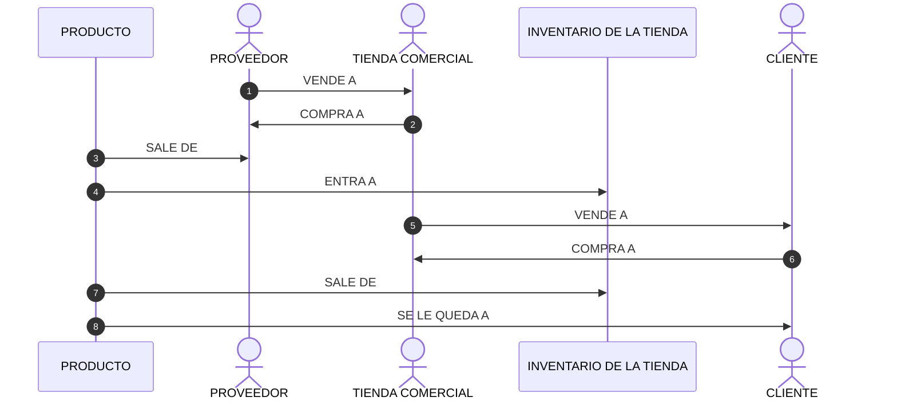
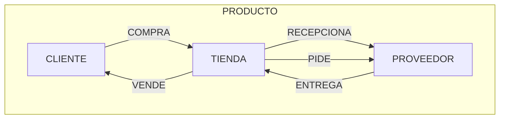
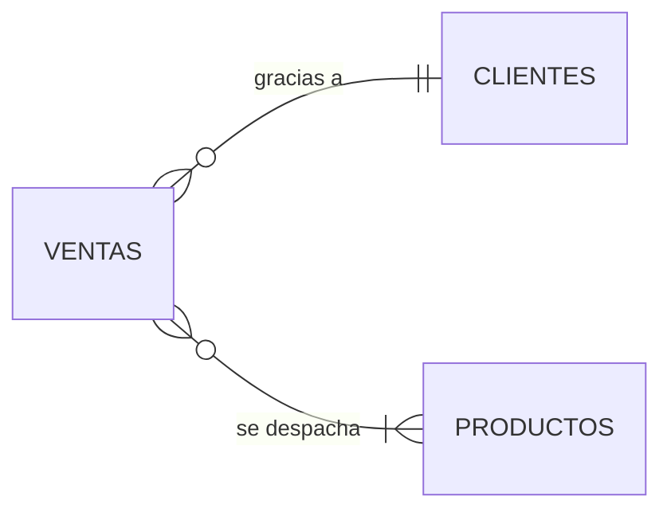
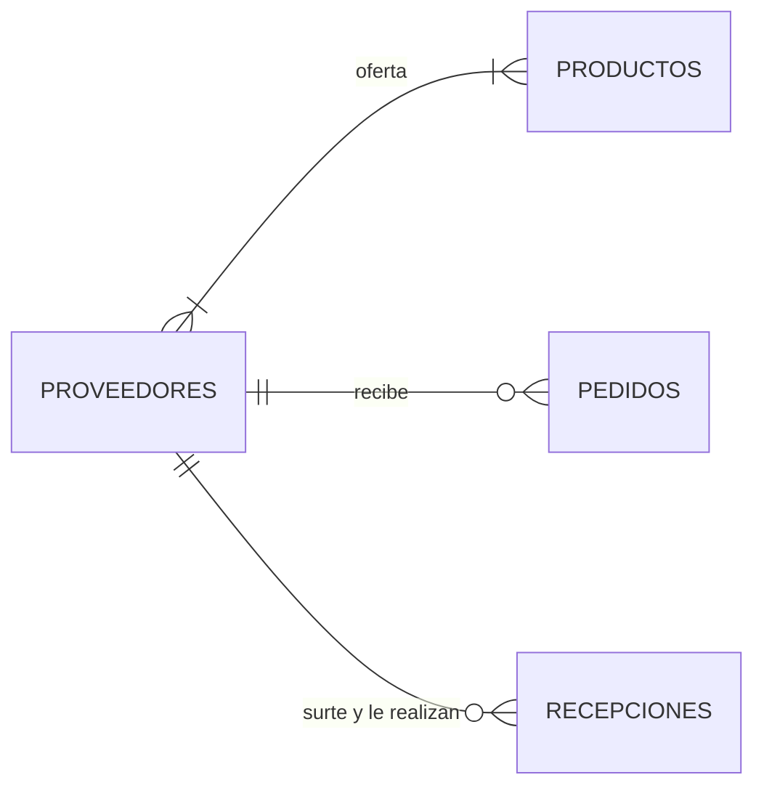
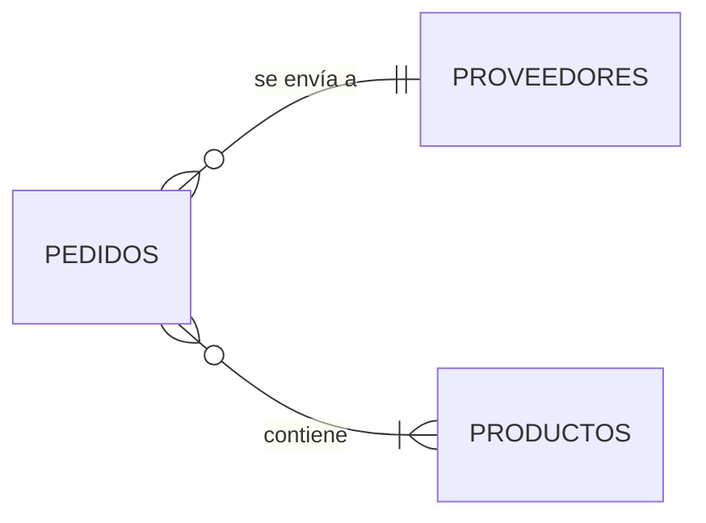
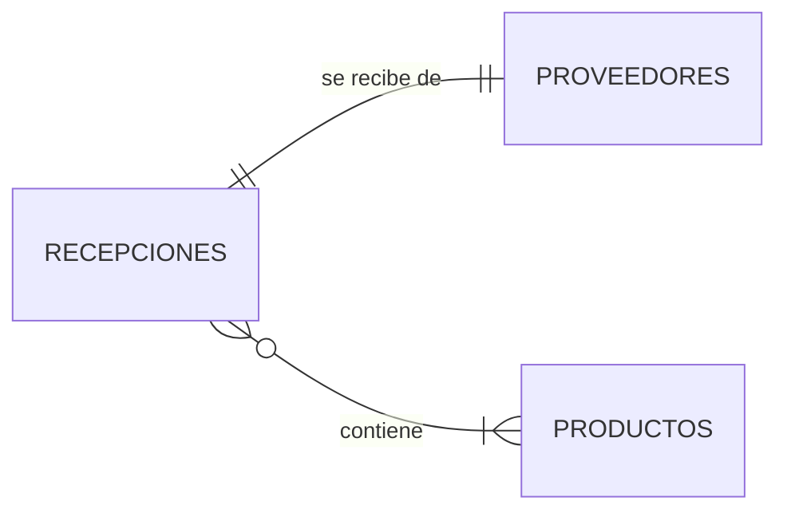
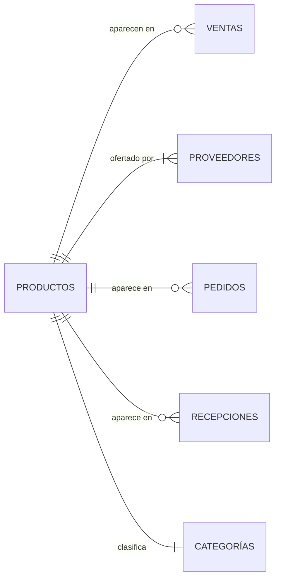
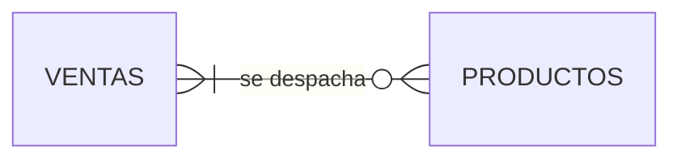
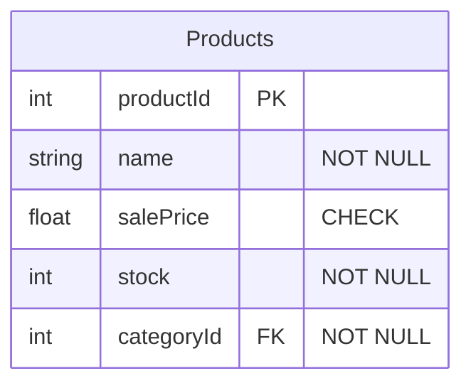
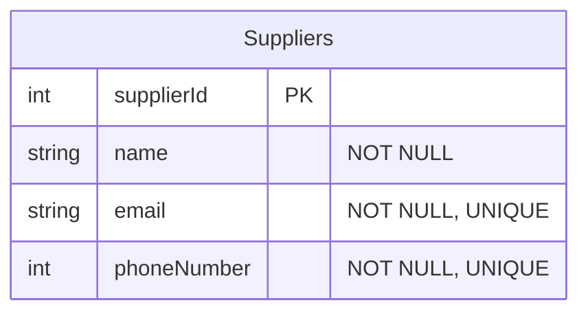

# Sistema de gestión de una tienda comercial

## Problemática

Una tienda comercial necesita organizar la información de sus productos, proveedores, clientes y ventas. Actualmente, los registros se llevan de manera desordenada, lo que dificulta conocer las existencias, identificar los productos más vendidos y consultar los ingresos generados. Por ello, la tienda se ha propuesto utilizar una base de datos como la solución que le facilite controlar productos, proveedores, clientes, ventas y detalles de ventas, manteniendo la integridad y consistencia de la información generada en algunas de sus operaciones.

Por lo tanto, se diseñará y desarollará una base de datos que permita administrar la información comercial y facilitar la generación de reportes. 

Los empleados de la empresa deben poder ejecutar las siguientes operaciones[^+]:
- **Listado** de los todos los productos registrados.
- **Búsqueda** de productos por nombre o categoría.
- **Consulta** de las ventas realizadas.
- **Consulta** de los productos más vendidos.
- **Cálculo** del total de ventas por periodo.
- **Identificación** de productos con existencias bajas.
- **Consulta** de ventas de un cliente específico.
- Utilización de operaciones de inserción y consulta de datos.
- Generación un reporte[^\*] que muestre los productos vendidos, las cantidades, los precios y el importe total vendido por producto.

Los puntos o conceptos más importantes de la problemática de la tienda son: `base de datos`, `productos`, `proveedores`, `clientes`, `ventas`, `detalles de ventas`, `generación de reportes`, `operaciones en la base de datos`. Estos conceptos son el núcleo de lo que el usuario (la tienda comercial) solicita como fundamental y crítico en su petición. En síntesis, la tienda requiere una base de datos para apoyar el **proceso o ciclo de compra-venta**.

[^+]: La mayoría de las operaciones no son descritas con precisión ni claridad. Se asumirán primero reglas intuitivas y sencillas, lo demás detalles serán tratados en la fase pertinente.

[^\*]: Un reporte de productos vendidos con formato de tabla cuyas columnas sean el producto, precio, cantidades e importe total vendido por producto. La indicación no es clara ni precisa, así que se asumirá un periodo desde el inicio de operaciones de la tienda, las cantidades y el importe serán las acumuladas desde apertura, y la identificación del producto se hará con su nombre y código de identificación.

## Modelo Conceptual

### Dominio

Dada la información obtenida en el enunciado de la problemática, el sistema o proceso de la tienda comercial a modelar es el *proceso o ciclo de compra-venta*. En tal modelo, los agentes y procesos principales son la **tienda**, el **producto**, el **inventario**, la **venta** y el **cliente** y el **proveedor**. Estos agentes y procesos se consideran parte de las entidades para un modelo relacional de bases de datos. Cabe añadir que las acciones de **vender** productos, **comprar** productos, **recepcionar** mercancía, **pedir** mercancía y **entregar** mercancía forman parte de los candidatos a relación.

El proceso de compra-venta en perspectiva del producto —y de forma simplificada— se muestra en el diagrama siguiente:


En tal flujo se observa de donde sale el producto y en donde termina, ahora tendremos que desglosar y exponer de forma descriptiva dicho diagrama. El producto es ofertado por el proveedor y este le vende dicho artículo a la tienda comercial. La tienda ingresa el producto a su inventario. La tienda le vende el artículo a un cliente, y el cliente lo compra. Es necesario aclarar que dicho proceso es simplificado y modela únicamente la secuencia de un único producto desde el almacén del proveedor hasta que el cliente lo hace suyo.



La secuencia anterior revela muy bien como se ejecuta el proceso de compra-venta de la tienda, por lo que de forma gráfica y resumida se expone más formal el proceso desde la perspectiva del producto:



### Entidades

> **Identificar las entidades.** Objetos o conceptos con existencia propia y relevancia para el dominio. Distinguir las *fuertes* de las *débiles*.

Una vez conocido el dominio se puede identifican las siguientes entidades:

- **Productos**.
- **Proveedores**.
- **Recepciones**.
- **Pedidos**.
- **Ventas**.
- **Clientes**.
- **Categorías**.
- **Existencias** o **inventario**.

De la lista anterior, se realiza un descarte de la entidad de **Existencias** por considerarse redundante con la existencia de la entidad de **Productos**. Esto se debe a que el primero únicamente guarda la relación de cantidades y su monto en precio de venta o costo y el segundo ya respalda las existencias de los productos y almacena los precios de costo y precio de venta. Por lo tanto, queda de esta manera las entidades para el modelo relacional:

| Entidad         | Descripción                                                                                           | Tipo de entidad |
| --------------- | ----------------------------------------------------------------------------------------------------- | --------------- |
| **Productos**   | Los artículos que vende una tienda, que adquiere el cliente y fabrica o distribuye un proveedor.      | Entidad fuerte. |
| **Proveedores** | Los agentes que entregan la mercancía a la tienda para que este lo distribuya y venda.                | Entidad fuerte. |
| **Recepciones** | El proceso de una tienda de recibir la mercancía al proveedor.                                        | Entidad fuerte. |
| **Pedidos**     | El proceso de una tienda de solicitar resurtido de mercancía al proveedor.                            | Entidad fuerte. |
| **Ventas**      | Las transacciones entre clientes y la tienda, donde el primero adquiere un artículo usando su dinero. | Entidad fuerte. |
| **Clientes**    | Los agentes que adquiere los productos ofertados por la tienda.                                       | Entidad fuerte. |
| **Categorías**  | La clasificación de la mercancía según su utilidad, caducidad u otros criterios.                      | Entidad fuerte. |

Por decisión de simplificación, las entidades anteriores descritas son *fuertes* ya que todas las anteriores se pueden identificar y existir por sí mismos ya que son abstracciones de los agentes y procesos del proceso de compra-venta.

De igual forma, se presenta las *entidades asociativas* como resultado a la solución de relaciones de cardinalidad `N:M`. En páginas siguientes se profundizará en estas relaciones.

| Entidad asociativa        | Descripción                                                              | Origen                                          |
| ------------------------- | ------------------------------------------------------------------------ | ----------------------------------------------- |
| **Catálogo de proveedor** | Los productos ofertados por los proveedores.                             | Relación entre **Productos** y **Proveedores**. |
| **Detalle de recepción**  | El desglose de mercancía recibida de un proveedor.                       | Relación entre **Productos** y **Recepciones**. |
| **Detalle de pedido**     | El desglose de mercancía solicitada a un proveedor.                      | Relación entre **Productos** y **Pedidos**.     |
| **Detalle de venta**      | El desglose de una venta, los productos y precios vendidos a un cliente. | Relación entre **Ventas** y **Productos**.      |

Las entidades se podrán identificar de dos formas:

- Productos -> `Products`
- Proveedores -> `Suppliers`
- Recepciones -> `Entries`
- Pedidos -> `Orders`
- Ventas -> `Sales`
- Clientes -> `Customers`
- Categorías -> `Categories
- Catálogo de proveedor -> `SupplierCatalogo`
- Detalle de recepción -> `EntryDetail`
- Detalle de pedido -> `OrderDetail`
- Detalle de venta -> `SaleDetail`

### Atributos de las entidades

A continuación se enumeran los *atributos* de las entidades fuertes identificadas y seleccionadas de la sección anterior.

- **Productos**:
	- Código de producto -> `productId`,
	- Nombre del producto -> `name`,
	- Precio de venta -> `salePrice` ,
	- Existencias -> `stock`, y
	- Categoría de producto -> `categoryId`.
- **Proveedores**:
	- Número de proveedor -> `supplierId`,
	- Nombre del proveedor -> `name`,
	- Correo electrónico -> `email`, y
	- Número telefónico -> `phoneNumber`.
- **Recepciones**:
	- Número de recepción -> `entryId,
	- Número de pedido a surtir -> `orderId`,
	- Número de proveedor -> `supplierId`, 
	- Referencia (número de nota de venta o de factura del proveedor) -> `reference`,
	- Fecha y hora de recepción -> `fullDate`, y
	- Valor monetario de la recepción (costo) -> `costEntry.
- **Pedidos**:
	- Número de pedido -> `orderId`,
	- Número de proveedor -> `supplierId`,
	- Fecha y hora del pedido -> `fullDate`, y
	- Valor monetario del pedido (costo) -> `costOrder`.
- **Ventas**:
	- Número de venta -> `ticket`,
	- Fecha y hora de la venta -> `fullDate`, 
	- Número de cliente -> `customerId`, y
	- Monto de venta -> `amount`.
- **Clientes**:
	- Número de cliente -> `customerId,
	- Nombre del cliente -> `name`,
	- Correo electrónico -> `email`, y
	- Número de teléfono -> `phoneNumber`.
- **Categorías**:
	- Identificador de categoría -> `categoryId`, y
	- Categoría `category`.

Listado de atributos de las entidades asociativas:

- **Catálogo de proveedor**:
	- Número de proveedor -> `supplierId`,
	- Código de producto -> `productId`, y
	- Costo unitario -> `unitCost`.
- **Detalle de recepción**:
	- Número de recepción -> `entryId`,
	- Código de producto -> `productId`,
	- Cantidad recibida por cada producto -> `quantity`,
	- Costo unitario `unitCost`, y
	- Valor monetario total por código de producto (costo) -> `totalCost`.
- **Detalle de pedido**:
	- Número de pedido -> `orderId`,
	- Código de producto -> `productId`,
	- Cantidad solicitada de cada producto -> `quantity`,
	- Costo unitario -> `unitCost`, y
	- Valor monetario total por código de producto (costo) -> `totalCost`.
- **Detalle de venta**:
	- Número de venta -> `ticket`,
	- Código de producto -> `productId`,
	- Cantidad vendida de cada producto -> `quantity`,
	- Precio unitario (precio venta) -> `unitPrice`, y
	- Valor monetario de cada producto -> `totalSale`.

### Claves primarias

Dada la sección anterior, se ha desglosado los atributos que contienen cada entidad fuerte y cada entidad asociativa. En la tabla siguiente se define las *claves primarias* de cada entidad.

| Entidad                   | Clave primaria                          | Tipo de entidad     |
| ------------------------- | --------------------------------------- | ------------------- |
| **Productos**             | Código de producto                      | Entidad fuerte.     |
| **Proveedores**           | Número de proveedor                     | Entidad fuerte.     |
| **Recepciones**           | Número de recepción                     | Entidad fuerte.     |
| **Pedidos**               | Número de pedido                        | Entidad fuerte.     |
| **Ventas**                | Número de venta                         | Entidad fuerte.     |
| **Clientes**              | Número de cliente                       | Entidad fuerte.     |
| **Categorías**            | Identificador de categoría              | Entidad fuerte.     |
| **Catálogo de proveedor** | Número de proveedor; Código de producto | Entidad asociativa. |
| **Detalle de recepción**  | Número de recepción; Código de producto | Entidad asociativa. |
| **Detalle de pedido**     | Número de pedido; Código de producto    | Entidad asociativa. |
| **Detalle de venta**      | Número de venta; Código de producto     | Entidad asociativa. |

### Relaciones

#### Relaciones por entidad

Una **venta** se realiza a un único **cliente** y contiene uno o varios **productos** que el cliente ha comprado. 



Un **cliente** puede realizar más de una compra, o no realizar ninguna. Estas compras se interpreta para la tienda como **ventas**. 


Un **proveedor** ofrece un catálogo de **productos** a la tienda y debe ofertar al menos un **producto**. También puede recibir cero o más **pedidos**; y estos lo surte o no, este último proceso es para la tienda una **recepción**.



Los **pedidos** se realizan a un solo **proveedor** y en ellas se debe solicitar al menos un **producto**.



Las **recepciones** son generadas cuando un **proveedor** surte un **pedido**. Cada recepción es generada por un único proveedor y un único pedido. Se debe recepcionar al menos un **producto**.



Los **productos** aparecen en ninguna o en más de una **venta**. Los productos puede ser ofertadas por uno o más **proveedores**. Un producto puede estar vinculados a cero o más **pedidos**, y de manera análoga, a cero o más **recepciones**. Cada producto está ligado a una sola **categoría**.



#### Relaciones entre dos entidades

A un **cliente** le pueden o no realizar una **venta**. Y toda **venta** está realizada a un único **cliente**. Esta es una relación de _cardinalidad_ `N:1`.


En una **venta** se despachan al menos un **producto**. Y todo **producto** puede aparecer en cero o más **ventas**. Esta es una relación de _cardinalidad_ `N:M`.



Los **productos** son ofertadas por uno o más **proveedores**. Todo **proveedor** debe ofertar al menos un **producto**.[^1] Esta es una relación de _cardinalidad_ `N:M`.

[^1]: Los proveedores se deben inscribir en un proceso aparte, si se realiza un acuerdo pero aún no oferta su catálogo o al menos un producto. Aquí solo se contempla aquellos que ya tienen cargados y disponibles su oferta.


Un **producto** tiene una sola **categoría** y una **categoría** clasifica a cero o más **productos**. Esta es una relación de _cardinalidad_ `1:N`.


Se realiza un **pedido** con al menos un **producto**. Y todo **producto** aparece en cero o más **pedidos**. Esta es una relación de _cardinalidad_ `N:M`.


En toda **recepción** se debe recibir al menos un **producto** y cada **producto** puede estar en varias **recepciones** o en ninguna. Esta es una relación de _cardinalidad_ `N:M`.


Los **proveedores** reciben varios **pedidos** o ninguno. Los **pedidos** se realizan a nombre de un solo **proveedor**. Esta es una relación de _cardinalidad_ `N:1`.


Las **recepciones** están a nombre de un solo **proveedor**. Y cada **proveedor** le puede realizar varias **recepciones** o ninguna. Esta es una relación de _cardinalidad_ `N:1`.


Las **recepciones** ocurren y se vinculan al surtirse un **pedido**. Un **pedido** puede generar una única **recepción** o nunca surtirse. Esta es una relación de _cardinalidad_ `1:1`.


### Relaciones N:M

Se presentan las entidades asociativas como resultado a la solución de relaciones de cardinalidad `N:M`. Son cuatro las relaciones `N:M` identificadas. Veáse las tablas de las entidades en la sección **Entidades**. En la tabla ulterior se ilustran las claves primarias de estas relaciones.

| Entidad                   | Clave primaria 1    | Clave primaria 2   | Tipo de entidad     |
| ------------------------- | ------------------- | ------------------ | ------------------- |
| **Catálogo de proveedor** | Número de proveedor | Código de producto | Entidad asociativa. |
| **Detalle de recepción**  | Número de recepción | Código de producto | Entidad asociativa. |
| **Detalle de pedido**     | Número de pedido    | Código de producto | Entidad asociativa. |
| **Detalle de venta**      | Número de venta     | Código de producto | Entidad asociativa. |

Veáse listado de atributos de las entidades asociativas en la sección **Atributos de las entidades**.

### Diagrama Entidad-Relación

> [!IMPORTANT]
> **FALTA EL DIAGRAMA DE ENTIDAD RELACIÓN CON NOTACIÓN DE PETER CHEN**

## Modelo Relacional

### Entidades en tablas





```mermaid
erDiagram
	Entries {
		int entryId PK
		int orderId FK "NOT NULL"
		int supplierId FK "NOT NULL"
		string reference "NOT NULL"
		datetime fullDate "NOT NULL"
		float costEntry "CHECK"
	}
```

```mermaid
erDiagram
	Orders {
		int orderId PK
		int supplierId FK "NOT NULL"
		datetime fullDate "NOT NULL"
		float costOrder "CHECK"
	}
```

```mermaid
erDiagram
	Sales {
		int ticket PK
		datetime fullDate "NOT NULL"
		int customerId FK "NOT NULL"
		float amount "CHECK"
	}
```

```mermaid
erDiagram
	Customers {
		int customerId PK
		string name "NOT NULL"
		string email "NOT NULL, UNIQUE"
		int phoneNumber "NOT NULL, UNIQUE"
	}
```

```mermaid
erDiagram
	Categories {
		int categoryId PK
		string category	"NOT NULL, UNIQUE"
	}
```

```mermaid
erDiagram
	SupplierCatalogo {
		int supplierId PK,FK
		int productId PK,FK
		float unitCost "CHECK"
	}
```

```mermaid
erDiagram
	EntryDetail {
		int entryId PK,FK
		int productId PK,FK
		int quantity "CHECK"
		float unitCost "CHECK"
		float totalCost "CHECK"
	}
```

```mermaid
erDiagram
	OrderDetail {
		int orderId PK,FK
		int productId PK,FK
		int quantity "CHECK"
		float unitCost "CHECK"
		float totalCost "CHECK"
	}
```

```mermaid
erDiagram
	SaleDetail {
		int ticket PK,FK
		int productId PK,FK
		int quantity "CHECK"
		float unitPrice "CHECK"
		float totalSale "CHECK"
	}
```

### Relaciones y claves foráneas

Véase la sección de **Relaciones entre dos identidades**. En la tabla se muestran las claves foráneas de las entidades:

| Entidad                   | Clave foránea                                  | Tipo de entidad     |
| ------------------------- | ---------------------------------------------- | ------------------- |
| **Productos**             | Categoría de producto                          | Entidad fuerte.     |
| **Proveedores**           | —                                              | Entidad fuerte.     |
| **Recepciones**           | Número de pedido a surtir; Número de proveedor | Entidad fuerte.     |
| **Pedidos**               | Número de proveedor                            | Entidad fuerte.     |
| **Ventas**                | Número de cliente                              | Entidad fuerte.     |
| **Clientes**              | —                                              | Entidad fuerte.     |
| **Categorías**            | —                                              | Entidad fuerte.     |
| **Catálogo de proveedor** | Número de proveedor; Código de producto        | Entidad asociativa. |
| **Detalle de recepción**  | Número de recepción; Código de producto        | Entidad asociativa. |
| **Detalle de pedido**     | Número de pedido; Código de producto           | Entidad asociativa. |
| **Detalle de venta**      | Número de venta; Código de producto            | Entidad asociativa. |

### Restricciones de seguridad

> Particapación total NOT NULL o NULL, no elegidas como PK pero candidatas UNIQUE, politica referencial ON DELETE y ON UPDATE (restrict, cascade, set null). reglas de dominio (CHECK)

### Esquema Relacional

> Esquema relacional con tablas, PK, FK y restricciones. 

## Diccionario de Datos

## Implementación de la Base de Datos

## Pruebas de la Base de Datos