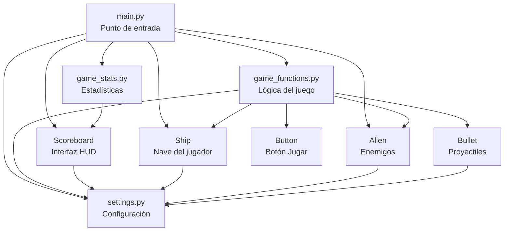
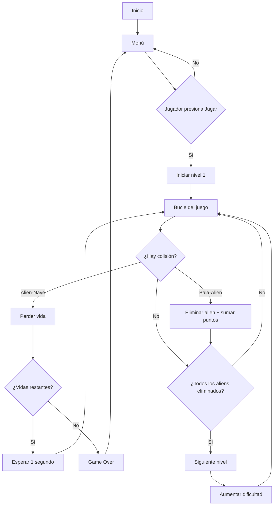

# Alien Invasion

Juego arcade 2D estilo _Space Invaders_ desarrollado con Python y Pygame. El jugador controla una nave espacial para eliminar oleadas de alienígenas mientras la dificultad aumenta progresivamente.

## Características

- Sistema de niveles con dificultad dinámica (velocidad y puntuación escalan por nivel).
- Sistema de audio completo con música de fondo y efectos de sonido.
- Puntuación persistente con high score guardado en archivo.
- Controles por teclado.
- Interfaz con HUD que muestra puntuación, nivel, vidas y high score.
- Botón «Jugar» para iniciar la partida.

## Controles

| Tecla | Acción |
|-------|--------|
| `←` / `A` | Mover nave a la izquierda |
| `→` / `D` | Mover nave a la derecha |
| `Espacio` / `S` | Disparar bala |
| `P` | Iniciar juego |
| `Q` | Salir del juego |
| **Ratón** | Clic en botón "Jugar" para iniciar |

## Requisitos previos

> [!IMPORTANT]
> Se requiere Python 3.x y la librería Pygame para ejecutar el juego.

- Python 3.x (desarrollado en Python 3.14.6)
- Pygame 2.6.1

## Instalación

1. Clona el repositorio:

```
git clone https://github.com/rosendocamal/alien-invasion.git
cd alien-invasion
```

2. Instala las dependencias:

```
pip install pygame
```

En algunos casos puede instalarse así:

```
sudo apt-get install python3-pygame
```

## Ejecución

```
python main.py
```

## Arquitectura del proyecto

El diagrama muestra cómo se relacionan los archivos, clases y funciones principales del proyecto.



## Flujo del juego

El siguiente diagrama de flujo muestra la dinámica del juego.



## Tecnologías utilizadas

| Tecnología | Versión | Propósito |
| -----------|---------|-----------|
|Python |	3.14.6 | Lenguaje de programación |
| Pygame | 2.6.1 | Framework de desarrollo de juegos 2D|
|BMP |	-|	Formato de sprites|
|WAV/MP3 |	-|	Formatos de audio|

>[!NOTE]
> No se requieren dependencias adicionales más allá de Pygame.

## Licencia

Este proyecto está licenciado bajo la licencia MIT. Consulta el archivo [LICENSE](LICENSE) para más detalles.

## Autor

Proyecto realizado por **Rosendo Camal**.

- GitHub: [rosendocamal](https://www.github.com/rosendocamal)
- LinkedIn: [rosendocamal](https://www.linkedin.com/in/rosendocamal)
